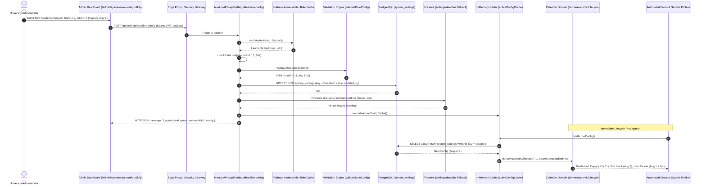

# Academic Calendar Cascade, Milestone Derivation & Deadline Configuration Engine (Forensic Truth)

**Module:** Dynamic Academic Calendar, Simulation Engine, Student Milestones & Administrative Settings  
**File Authority:** `src/domains/calendar/repositories/calendar.repository.ts`, `src/app/api/settings/deadline-config/route.ts`, `src/app/api/admin/simulate-deadlines/route.ts`  
**Database Tables:** `system_settings`, `academic_deadlines`, `student_profiles`  

---

# PART 5: Dynamic Academic Calendar Engine, Simulation Mode, Deadline Configuration & Per-Student Milestone Derivation

---

### 5.1 Sub-Domain Architecture & Exact Execution Pipeline

The Dynamic Academic Calendar Engine provides the temporal baseline for all lifecycle operations across ADTU ITMS. Rather than hardcoding fixed calendar dates (such as June 30 or July 1) across database queries or application forms, the system stores an abstract anchor configuration (`academicSessionStart: { month, day }`) in PostgreSQL `system_settings` (with a secondary fallback in Firestore `settings/deadline`).

From this single annual anchor point, the mathematical engine in `src/lib/utils/deadline-computation.ts` programmatically projects the exact lifecycle milestones for each individual commuter based on their enrolled `sessionEndYear` or `valid_until` timestamp:
1. **Academic Session Start:** `Date.UTC(effectiveYear - 1, startMonth, startDay, 0, 0, 0, 0)`
2. **Bus Service Expiry Date:** `Date.UTC(effectiveYear, startMonth, startDay - 1, 23, 59, 59, 999)`
3. **Reminder 1 (90-Day Early Warning):** 1st of the month, 3 months prior to expiry.
4. **Reminder 2 (60-Day Mid Warning):** 1st of the month, 2 months prior to expiry.
5. **Final Reminder (15-Day Urgent Notice):** Exactly 15 days prior to expiry.
6. **Renewal Deadline:** Identical to Expiry date.
7. **Soft Block & Seat Release Date:** Exactly `Date.UTC(effectiveYear, startMonth, startDay, 0, 0, 0, 0)` (start of the new academic cycle).
8. **Hard Deletion Date:** Programmed as `Date.UTC(effectiveYear + 2, startMonth, startDay, 0, 0, 0, 0)`.

#### Dataflow & Lifecycle Projection Pipeline

```
[ PostgreSQL: public.system_settings (key = 'deadline') ]
                       │
                       │ 5-minute memory cache (activeConfigCache)
                       ▼
            [ findActiveConfig() ] (calendar.repository.ts)
                       │
                       ├─► academicSessionStart: { month, day } (e.g. Month 6 [July], Day 1)
                       │
                       ▼
       [ deriveAcademicLifecycle(startMonth, startDay, effectiveYear) ]
                       │
       ┌───────────────┼───────────────┬───────────────┬───────────────┐
       ▼               ▼               ▼               ▼               ▼
[ Reminder 1 ]  [ Final Reminder ] [ Expiry Date ] [ Soft Block ] [ Hard Delete ]
  (3 mo prior)     (15d prior)      (Session End)   (Session Start) (Two Cycles Later)
       │               │               │               │               │
       ▼               ▼               ▼               ▼               ▼
[ Expiry Cron ] [ Expiry Cron ] [ Application ] [ Cleanup Cron ] [ Cleanup Cron ]
 (/cron/expiry)  (/cron/expiry)   Approve / Form  (Soft-Block)     (Hard-Delete)
```

#### Critical Architectural Anomaly & Reality: Discrepancy Matrix

A forensic audit of the codebase reveals contradictory statements between file comments, metadata descriptions, and actual executable code:

| Layer / File Location | Stated Rule / Value | Codebase Reality & Execution Impact |
| :--- | :--- | :--- |
| **`deadline-computation.ts` Header Comment (Line 10)** | `"3. Hard delete ALWAYS occurs in sessionEndYear + 1 (next academic cycle)"` | **CONTRADICTED BY LINE 188.** The comment claims hard delete occurs in `sessionEndYear + 1`, but the executable code computes `effectiveYear + 2`. |
| **`deriveAcademicLifecycle` Executable Code (Line 188)** | `const hardDelete = new Date(Date.UTC(effectiveYear + 2, startMonth, startDay, 0, 0, 0, 0));` | **THIS IS THE RUNNING TRUTH.** For a student whose session ends on June 30, 2026 (`effectiveYear = 2026`), `hardDelete` is computed and stored as **July 1, 2028 00:00:00 UTC** (two full academic sessions after expiry). |
| **`calendar.repository.ts` Metadata (Lines 144–145)** | `daysAfterDeadline: 60, daysAfterSoftBlock: 45` | **DOCUMENTATION STRINGS ONLY.** These fields are purely human-readable metadata strings in `DeadlineConfig` and are never used in any date comparison logic or database query. |
| **`cleanup-expired-students/route.ts` Cron Job (Lines 166–185)** | `shouldHardDeleteFromStoredDates(studentCheckData, null, config)` | **THE CRON OPERATES DIRECTLY AGAINST STORED `hard_block`.** The automated deletion cron evaluates `currentDate >= new Date(studentData.hardBlock)`. Because `hard_block` was stamped via `deriveAcademicLifecycle` as `effectiveYear + 2`, students receive a **two-year retention buffer** in soft-blocked status before permanent database and Firebase account purging. |
| **`/api/settings/deadline-config` Lock Check** | `checkDependencies()` checks `student_profiles` and `applications` in `verified_upcoming` or `pending_seat_allocation` | **UI ADVISORY LOCK ONLY.** `checkDependencies()` is called exclusively during `GET` to return `hasDependencies: boolean` to the client UI. The `POST` mutation handler **does not call `checkDependencies()`** and allows administrative overwrites even when active student dependencies exist! |

---

### 5.2 File, Component, Hook, API & Service Inventory

| File Path | Exported Functions / Components | Callers (Who calls it) | Callees (What it calls) | Database Tables / Caches Mutated |
| :--- | :--- | :--- | :--- | :--- |
| `src/domains/calendar/repositories/calendar.repository.ts` | `findActiveConfig`, `saveConfig`, `invalidateActiveConfigCache`, `setActiveConfigForTesting` | `calendar.service.ts`, `deadline-config-service.ts` | `getSupabaseServer`, `deriveAcademicLifecycle` | Queries and mutates `public.system_settings` (key `'deadline'`). In-memory 5-minute cache (`activeConfigCache`). |
| `src/domains/calendar/services/calendar.service.ts` | `getActiveConfig`, `updateConfig`, `computeSession` | API routes, Cron workers, Application Approval services | `calendar.repository.ts`, `deriveAcademicLifecycle` | Thin domain orchestration layer. |
| `src/lib/utils/deadline-computation.ts` | `deriveAcademicLifecycle`, `computeDatesForStudent`, `computeBlockDatesFromValidUntil`, `shouldSoftBlockStudent`, `shouldHardDeleteStudent`, `generateDatePreview`, `normalizeLeapYearDate`, `validateDateConfig` | Application domain, Renewal routes, Cron jobs, Identity domain | Pure mathematical date engine. | Zero database side effects. |
| `src/app/api/settings/deadline-config/route.ts` | `GET`, `POST` | Admin System Settings UI (`/admin/system-settings`), Admin Renewal Dashboard | `getDeadlineConfig`, `updateDeadlineConfig`, `checkDependencies`, `validateDateConfig`, `getUserById` | Reads `student_profiles`, `applications`, `system_settings`. Updates `system_settings` and Firestore. |
| `src/lib/utils/renewal-utils.ts` | `shouldBlockAccessFromStoredDates`, `shouldHardDeleteFromStoredDates`, `calculateRenewalDate`, `formatRenewalDate` | `cleanup-expired-students/route.ts`, Student portal | `deriveAcademicLifecycle` | Evaluates pre-stored student dates against simulation or system clock. |

---

### 5.3 Method-by-Method Low-Level Walkthrough

#### 1. `findActiveConfig` (`src/domains/calendar/repositories/calendar.repository.ts`)
- **Signature:** `export async function findActiveConfig(): Promise<DeadlineConfig>`
- **Control Flow:**
  1. Checks `activeConfigCache`. If `Date.now() < activeConfigCache.expiresAt` (5-minute TTL), returns cached object immediately.
  2. Queries PostgreSQL `system_settings`:
     ```typescript
     const { data, error } = await supabase
       .from('system_settings')
       .select('value')
       .eq('key', 'deadline')
       .maybeSingle();
     ```
  3. If missing from PostgreSQL, derives dates from default academic calendar configuration.
  4. Resolves `startMonth` (defaults to 6 [July]) and `startDay` (defaults to 1).
  5. Derives full lifecycle milestones via `deriveAcademicLifecycle(startMonth, startDay, currentYear)`.
  6. Assembles `DeadlineConfig` object containing:
     - `academicSessionStart: { month, day }`
     - `academicYear: { anchorMonth, anchorDay, ... }`
     - `renewalNotification: { daysBeforeDeadline: 90, ... }`
     - `renewalDeadline: { hour: 23, minute: 59, ... }`
     - `softBlock: { daysAfterDeadline: 15, warningText, ... }`
     - `hardDelete: { daysAfterDeadline: 60, daysAfterSoftBlock: 45, criticalWarningText, ... }`
     - `urgentWarningThreshold: { days: 15 }`
     - `timeline: { events: [...] }`
  7. Populates `activeConfigCache` with 5-minute TTL and returns.

#### 2. `deriveAcademicLifecycle` (`src/lib/utils/deadline-computation.ts`)
- **Signature:** `export function deriveAcademicLifecycle(startMonth: number, startDay: number, effectiveYear: number): DerivedLifecycle`
- **Mathematical Rules & Step-by-Step Execution:**
  1. `sessionStart = Date.UTC(effectiveYear - 1, startMonth, startDay, 0, 0, 0, 0)`
  2. `expiry = Date.UTC(effectiveYear, startMonth, startDay, 0, 0, 0, 0)`:
     - Subtracts 1 day: `expiry.setUTCDate(expiry.getUTCDate() - 1)`.
     - Sets end of day: `expiry.setUTCHours(23, 59, 59, 999)`.
     - *Example:* For startMonth=6 (July), startDay=1, effectiveYear=2026: Expiry is **June 30, 2026 23:59:59.999 UTC**.
  3. `reminder1`: Subtracts 3 months from `expiry`, resets to day 1, hour 00:00:00 (e.g. **April 1, 2026**).
  4. `reminder2`: Subtracts 2 months from `expiry`, resets to day 1, hour 00:00:00 (e.g. **May 1, 2026**).
  5. `finalReminder`: Subtracts 15 days from `expiry` (e.g. **June 15, 2026**).
  6. `deadline`: Identical to `expiry` (**June 30, 2026**).
  7. `softBlock = Date.UTC(effectiveYear, startMonth, startDay, 0, 0, 0, 0)` (e.g. **July 1, 2026 00:00:00 UTC**).
  8. `activation = Date.UTC(effectiveYear, startMonth, startDay, 0, 0, 0, 0)` (e.g. **July 1, 2026**).
  9. `hardDelete = Date.UTC(effectiveYear + 2, startMonth, startDay, 0, 0, 0, 0)` (e.g. **July 1, 2028 00:00:00 UTC**).
  10. Iterates over all 9 dates and executes `normalizeLeap`: If non-leap year and date lands on Feb 29, shifts to Feb 28.

#### 3. `computeBlockDatesFromValidUntil` (`src/lib/utils/deadline-computation.ts`)
- **Signature:** `export function computeBlockDatesFromValidUntil(validUntil: string | Date, config: DeadlineConfig): { softBlock: string; hardBlock: string }`
- **Control Flow:**
  1. Parses `validUntil` date and extracts `validUntilYear = validUntilDate.getUTCFullYear()`.
  2. Extracts `startMonth` and `startDay` from `config.academicSessionStart`.
  3. Invokes `deriveAcademicLifecycle(startMonth, startDay, validUntilYear)`.
  4. Returns `{ softBlock: lifecycle.softBlock.toISOString(), hardBlock: lifecycle.hardDelete.toISOString() }`.

#### 4. `checkDependencies` (`src/app/api/settings/deadline-config/route.ts`)
- **Signature:** `async function checkDependencies(): Promise<boolean>`
- **Control Flow:**
  1. Issues 3 parallel PostgreSQL count queries with `{ count: 'exact', head: true }`:
     - Query 1: `student_profiles` (limit 1)
     - Query 2: `applications` where `state = 'verified_upcoming'` (limit 1)
     - Query 3: `applications` where `state = 'pending_seat_allocation'` (limit 1)
  2. If any query returns a count > 0, returns `true`.
  3. On unexpected database error, fails closed and returns `true`.

#### 5. `POST /api/settings/deadline-config` (`src/app/api/settings/deadline-config/route.ts`)
- **Signature:** `export async function POST(req: NextRequest): Promise<NextResponse>`
- **Control Flow:**
  1. Validates Bearer token via `adminAuth.verifyIdToken(token)`.
  2. Resolves user from PostgreSQL: `getUserById(uid)`. If `user.role !== 'admin'`, returns `403 Forbidden`.
  3. Sanitizes body via `stripUnsafeObjectKeys(rawConfig)`.
  4. Validates date values via `validateDateConfig(config)`:
     - Month must be an integer between 0 and 11.
     - Day must be an integer between 1 and the maximum days of that month (using non-leap February baseline max 29).
  5. Calls `updateDeadlineConfig(config, uid)`:
     - Writes payload to PostgreSQL `system_settings` (`key = 'deadline'`).
     - Dual-writes to Firestore `settings/deadline`.
     - Invalidates `activeConfigCache`.
  6. **Notice:** Does NOT call `checkDependencies()`! Admins are permitted to update the configuration at any time.

---

### 5.4 Exact I/O, Database Query, Redis & External API Count Matrix

| Execution Context | PostgreSQL Queries / RPCs Executed | Redis Commands | External Network Calls | Latency Profile |
| :--- | :--- | :--- | :--- | :--- |
| **(a) GET /api/settings/deadline-config (Cold Cache)** | 4 queries: 1 SELECT on `system_settings` (`findActiveConfig`), 3 HEAD queries on `student_profiles` and `applications` (`checkDependencies`) | 0 | 0 (or 1 Firestore read if PostgreSQL setting is empty) | ~35ms - 70ms |
| **(b) GET /api/settings/deadline-config (Warm Cache)** | 3 queries: 0 for config (served from `activeConfigCache`), 3 HEAD queries for `checkDependencies()` | 0 | 0 | ~15ms - 30ms |
| **(c) POST /api/settings/deadline-config (Config Update)** | 2 queries: 1 SELECT on `users` (admin role check), 1 UPSERT on `system_settings` | 0 | 1 Firebase Auth token verify + 1 Firestore doc set (`merge: true`) | ~90ms - 160ms |
| **(d) Per-Student Date Derivation in Application / Approval Flow** | 0 queries (Uses cached `DeadlineConfig` and in-memory `deriveAcademicLifecycle` computation) | 0 | 0 | < 1ms |

---

### 5.5 Verbatim Source Code from Live Codebase

#### 1. `src/domains/calendar/repositories/calendar.repository.ts` (Lines 1–256)
```typescript
/**
 * D2 Calendar Repository — PostgreSQL Implementation
 *
 * Persistence owner: PostgreSQL system_settings (`key = 'deadline'`).
 * Business computation (`deriveAcademicLifecycle`) stays in CalendarService / deadline-computation.
 */

import { getSupabaseServer } from '@/lib/supabase-server';
import type { DeadlineConfig } from '@/lib/types/deadline-config';
import { deriveAcademicLifecycle } from '@/lib/utils/deadline-computation';

const MONTH_NAMES = [
  'January', 'February', 'March', 'April', 'May', 'June',
  'July', 'August', 'September', 'October', 'November', 'December',
];

const getOrdinal = (day: number): string => {
  if (day > 3 && day < 21) return 'th';
  switch (day % 10) {
    case 1: return 'st';
    case 2: return 'nd';
    case 3: return 'rd';
    default: return 'th';
  }
};

const CACHE_TTL_MS = 5 * 60 * 1000; // 5-minute TTL
let activeConfigCache: { data: DeadlineConfig; expiresAt: number } | null = null;

export function invalidateActiveConfigCache(): void {
  activeConfigCache = null;
}

export function setActiveConfigForTesting(config: DeadlineConfig): void {
  activeConfigCache = { data: config, expiresAt: Date.now() + CACHE_TTL_MS };
}

export function getCachedActiveConfig(): DeadlineConfig | null {
  return activeConfigCache?.data || null;
}

export async function findActiveConfig(): Promise<DeadlineConfig> {
  if (activeConfigCache && Date.now() < activeConfigCache.expiresAt) {
    return activeConfigCache.data;
  }

  let firestoreData: Record<string, any> = {};

  // 1. Query PostgreSQL system_settings (Authoritative Source of Truth)
  try {
    if (process.env.NEXT_PUBLIC_SUPABASE_URL) {
      const supabase = getSupabaseServer();
      const { data, error } = await supabase
        .from('system_settings')
        .select('value')
        .eq('key', 'deadline')
        .maybeSingle();
      if (!error && data?.value && Object.keys(data.value).length > 0) {
        firestoreData = data.value;
      }
    }
  } catch {
    // Return standard defaults if DB is temporarily unreachable
  }

  const startMonth = typeof firestoreData.academicSessionStart?.month === 'number'
    ? firestoreData.academicSessionStart.month
    : 6; // July default (0-indexed)
  const startDay = firestoreData.academicSessionStart?.day || 1;
  const currentYear = new Date().getFullYear();
  const lifecycle = deriveAcademicLifecycle(startMonth, startDay, currentYear);

  const config: DeadlineConfig = {
    description: firestoreData.description ?? 'Academic Calendar Configuration',
    version: firestoreData.version ?? '1.0.0',
    lastUpdated: firestoreData.lastUpdated ?? new Date().toISOString(),
    lastUpdatedBy: firestoreData.lastUpdatedBy ?? 'system',

    academicSessionStart: {
      month: startMonth,
      day: startDay,
    },

    academicYear: {
      description: 'Academic year boundary',
      anchorMonth: lifecycle.expiry.getUTCMonth(),
      anchorMonthName: MONTH_NAMES[lifecycle.expiry.getUTCMonth()],
      anchorDay: lifecycle.expiry.getUTCDate(),
      anchorDayOrdinal: getOrdinal(lifecycle.expiry.getUTCDate()),
    },

    renewalNotification: {
      description: 'Renewal notification start date',
      month: lifecycle.reminder1.getUTCMonth(),
      monthName: MONTH_NAMES[lifecycle.reminder1.getUTCMonth()],
      day: lifecycle.reminder1.getUTCDate(),
      dayOrdinal: getOrdinal(lifecycle.reminder1.getUTCDate()),
      hour: 0,
      minute: 5,
      daysBeforeDeadline: 90,
      displayText: 'Renewal notification period has started',
    },

    renewalDeadline: {
      description: 'Renewal deadline date',
      month: lifecycle.deadline.getUTCMonth(),
      monthName: MONTH_NAMES[lifecycle.deadline.getUTCMonth()],
      day: lifecycle.deadline.getUTCDate(),
      dayOrdinal: getOrdinal(lifecycle.deadline.getUTCDate()),
      hour: 23,
      minute: 59,
      displayText: 'Renewal deadline date',
    },

    softBlock: {
      description: 'Service expiration date (dashboard & live tracking restricted until renewal)',
      month: lifecycle.softBlock.getUTCMonth(),
      monthName: MONTH_NAMES[lifecycle.softBlock.getUTCMonth()],
      day: lifecycle.softBlock.getUTCDate(),
      dayOrdinal: getOrdinal(lifecycle.softBlock.getUTCDate()),
      daysAfterDeadline: 15,
      displayText: 'Service expired — dashboard & live tracking restricted until renewal',
      warningText: firestoreData.softBlock?.warningText || "Student's access to dashboard and live bus tracking will be restricted after this date.",
    },

    hardDelete: {
      description: 'Hard delete date (account removal)',
      month: lifecycle.hardDelete.getUTCMonth(),
      monthName: MONTH_NAMES[lifecycle.hardDelete.getUTCMonth()],
      day: lifecycle.hardDelete.getUTCDate(),
      dayOrdinal: getOrdinal(lifecycle.hardDelete.getUTCDate()),
      daysAfterDeadline: 60,
      daysAfterSoftBlock: 45,
      displayText: 'Hard delete scheduled',
      criticalWarningText: firestoreData.hardDelete?.criticalWarningText || 'Warning: Account will be permanently deleted.',
    },

    urgentWarningThreshold: {
      description: 'Days before hard delete for warning',
      days: firestoreData.urgentWarningThreshold?.days ?? 15,
      displayText: 'Critical warning period',
    },

    contactInfo: firestoreData.contactInfo ?? {
      description: 'Contact office info',
      officeName: 'AdtU Transport Office',
      phone: '+91 93657 71454',
      email: 'support@adtu.in',
      officeHours: 'Mon-Fri 9:00 AM - 5:00 PM',
      address: 'Panikhaiti, Guwahati, Assam 781026',
      visitInstructions: 'Please visit during office hours with your valid student ID.',
    },

    timeline: {
      description: 'Academic Session Timeline Events',
      events: [
        {
          id: 'session_start',
          date: { month: startMonth, day: startDay },
          label: 'Academic Session Starts',
          color: 'blue',
          icon: 'calendar',
        },
        {
          id: 'expiry',
          date: { month: lifecycle.expiry.getUTCMonth(), day: lifecycle.expiry.getUTCDate() },
          label: 'Bus Service Expires',
          color: 'amber',
          icon: 'clock',
        },
        {
          id: 'soft_block',
          date: { month: lifecycle.softBlock.getUTCMonth(), day: lifecycle.softBlock.getUTCDate() },
          label: 'Service Expired (Access Restricted)',
          color: 'orange',
          icon: 'alert-triangle',
        },
        {
          id: 'hard_delete',
          date: { month: lifecycle.hardDelete.getUTCMonth(), day: lifecycle.hardDelete.getUTCDate() },
          label: 'Hard Delete Scheduled',
          color: 'red',
          icon: 'trash-2',
          critical: true,
        },
      ],
    },
  };

  activeConfigCache = { data: config, expiresAt: Date.now() + CACHE_TTL_MS };
  return config;
}

export async function saveConfig(config: DeadlineConfig, updatedByUid?: string): Promise<void> {
  const payload = {
    description: config.description,
    version: config.version,
    lastUpdated: new Date().toISOString(),
    lastUpdatedBy: updatedByUid || 'admin',
    academicSessionStart: {
      month: config.academicSessionStart.month,
      day: config.academicSessionStart.day,
    },
    urgentWarningThreshold: {
      days: config.urgentWarningThreshold.days,
    },
    softBlock: {
      warningText: config.softBlock.warningText,
    },
    hardDelete: {
      criticalWarningText: config.hardDelete.criticalWarningText,
    },
    contactInfo: config.contactInfo,
  };

  // 1. Write to PostgreSQL system_settings
  try {
    if (process.env.NEXT_PUBLIC_SUPABASE_URL) {
      const supabase = getSupabaseServer();
      await supabase.from('system_settings').upsert({
        key: 'deadline',
        value: payload,
        updated_at: payload.lastUpdated,
        updated_by: updatedByUid || 'admin',
      });
    }
  } catch (err) {
    console.warn('[calendar.repository] Failed to persist deadline to PostgreSQL system_settings:', err);
  }

  invalidateActiveConfigCache();
}
```

#### 2. `src/domains/calendar/services/calendar.service.ts` (Lines 1–29)
```typescript
/**
 * CalendarService
 *
 * Responsibilities: read/update academic calendar config, derive
 * per-student lifecycle dates (AcademicSession).
 */
import type { DeadlineConfig } from '@/lib/types/deadline-config';
import { deriveAcademicLifecycle, type DerivedLifecycle } from '@/lib/utils/deadline-computation';
import * as calendarRepository from '../repositories/calendar.repository';

export async function getActiveConfig(): Promise<DeadlineConfig> {
  return calendarRepository.findActiveConfig();
}

export async function updateConfig(config: DeadlineConfig, updatedByUid?: string): Promise<void> {
  return calendarRepository.saveConfig(config, updatedByUid);
}

/**
 * Computes the derived AcademicSession lifecycle (expiry, reminders,
 * soft block, hard delete) for a given session end year, using the
 * active config's academicSessionStart month/day.
 */
export async function computeSession(sessionEndYear: number): Promise<DerivedLifecycle> {
  const config = await getActiveConfig();
  const { month, day } = config.academicSessionStart;
  return deriveAcademicLifecycle(month, day, sessionEndYear);
}
```

#### 3. `src/lib/utils/deadline-computation.ts` (Lines 144–266, 527–550)
```typescript
export interface DerivedLifecycle {
    sessionStart: Date;
    expiry: Date;
    reminder1: Date;
    reminder2: Date;
    finalReminder: Date;
    deadline: Date;
    softBlock: Date;
    activation: Date;
    hardDelete: Date;
}

/**
 * Derives all lifecycle dates programmatically from the single Academic Session Start month and day.
 * Applies leap year normalization across all derived dates.
 */
export function deriveAcademicLifecycle(
    startMonth: number,
    startDay: number,
    effectiveYear: number
): DerivedLifecycle {
    // Session Start date in the previous calendar year relative to sessionEndYear (effectiveYear)
    const sessionStart = new Date(Date.UTC(effectiveYear - 1, startMonth, startDay, 0, 0, 0, 0));

    // Expiry date is 1 day before the next session start of the effectiveYear
    const expiry = new Date(Date.UTC(effectiveYear, startMonth, startDay, 0, 0, 0, 0));
    expiry.setUTCDate(expiry.getUTCDate() - 1);
    expiry.setUTCHours(23, 59, 59, 999);

    // Reminder 1 is 3 months before expiry (1st of that month)
    const reminder1 = new Date(expiry);
    reminder1.setUTCMonth(reminder1.getUTCMonth() - 3);
    reminder1.setUTCDate(1);
    reminder1.setUTCHours(0, 0, 0, 0);

    // Reminder 2 is 2 months before expiry (1st of that month)
    const reminder2 = new Date(expiry);
    reminder2.setUTCMonth(reminder2.getUTCMonth() - 2);
    reminder2.setUTCDate(1);
    reminder2.setUTCHours(0, 0, 0, 0);

    // Final Reminder is 15 days before expiry
    const finalReminder = new Date(expiry);
    finalReminder.setUTCDate(finalReminder.getUTCDate() - 15);
    finalReminder.setUTCHours(0, 0, 0, 0);

    // Renewal Deadline is equal to expiry
    const deadline = new Date(expiry);

    // Soft Block is exactly when next session starts (e.g. July 1, 2026 at 00:00:00)
    const softBlock = new Date(Date.UTC(effectiveYear, startMonth, startDay, 0, 0, 0, 0));

    // Future Session Activation starts on the same day as soft block (July 1st)
    const activation = new Date(Date.UTC(effectiveYear, startMonth, startDay, 0, 0, 0, 0));

    // Hard Delete is two sessions after expiry (e.g. July 1, 2028)
    const hardDelete = new Date(Date.UTC(effectiveYear + 2, startMonth, startDay, 0, 0, 0, 0));

    // Apply consistency normalization to all leap years
    const normalizeLeap = (d: Date) => {
        const y = d.getUTCFullYear();
        const m = d.getUTCMonth();
        const day = d.getUTCDate();
        if (m === 1 && day === 29) { // Feb 29
            const isLeapYear = (y % 4 === 0 && y % 100 !== 0) || (y % 400 === 0);
            if (!isLeapYear) {
                d.setUTCMonth(1, 28);
            }
        }
    };

    [sessionStart, expiry, reminder1, reminder2, finalReminder, deadline, softBlock, activation, hardDelete].forEach(normalizeLeap);

    return {
        sessionStart,
        expiry,
        reminder1,
        reminder2,
        finalReminder,
        deadline,
        softBlock,
        activation,
        hardDelete
    };
}

/**
 * Compute all deadline dates for a specific student
 */
export function computeDatesForStudent(params: ComputeDateParams): ComputedDates {
    const {
        studentSessionEndYear,
        config,
        simulationMode
    } = params;

    if (!config) throw new Error("Config required for computeDatesForStudent");

    const isSimulated = simulationMode?.enabled ?? false;
    const effectiveYear = isSimulated
        ? simulationMode!.customYear
        : studentSessionEndYear;

    if (!config?.academicSessionStart || typeof config.academicSessionStart.month !== 'number') {
        throw new Error('Academic session start configuration missing in deadline settings. Please configure settings and try again later.');
    }

    const startMonth = config.academicSessionStart.month;
    const startDay = config.academicSessionStart.day || 1;

    const lifecycle = deriveAcademicLifecycle(startMonth, startDay, effectiveYear);

    const urgentWarningDays = config.urgentWarningThreshold?.days ?? 15;
    const urgentWarningDate = new Date(lifecycle.hardDelete);
    urgentWarningDate.setUTCDate(
        urgentWarningDate.getUTCDate() - urgentWarningDays
    );
    urgentWarningDate.setUTCHours(0, 0, 0, 0);

    return {
        serviceExpiryDate: lifecycle.expiry,
        renewalNotificationDate: lifecycle.reminder1,
        renewalDeadlineDate: lifecycle.deadline,
        softBlockDate: lifecycle.softBlock,
        hardDeleteDate: lifecycle.hardDelete,
        urgentWarningDate,
        effectiveYear,
        isSimulated
    };
}

export function computeBlockDatesFromValidUntil(
    validUntil: string | Date,
    config: DeadlineConfig
): { softBlock: string; hardBlock: string } {
    if (!config) throw new Error("Config required for computeBlockDatesFromValidUntil");

    const validUntilDate = typeof validUntil === 'string' ? new Date(validUntil) : validUntil;
    const validUntilYear = validUntilDate.getUTCFullYear();

    if (!config?.academicSessionStart || typeof config.academicSessionStart.month !== 'number') {
        throw new Error('Academic session start configuration missing in deadline settings. Please configure settings and try again later.');
    }

    const startMonth = config.academicSessionStart.month;
    const startDay = config.academicSessionStart.day || 1;

    const lifecycle = deriveAcademicLifecycle(startMonth, startDay, validUntilYear);

    return {
        softBlock: lifecycle.softBlock.toISOString(),
        hardBlock: lifecycle.hardDelete.toISOString()
    };
}
```

#### 4. `src/app/api/settings/deadline-config/route.ts` (Lines 1–177)
```typescript
import { invalidateConfigCache } from '@/domains/admin';
import { invalidateActiveConfigCache } from '@/domains/calendar';
import { invalidateStudentAssignmentCache } from '@/domains/student';
import { getUserById } from '@/domains/identity';
import { getDeadlineConfig, updateDeadlineConfig } from '@/lib/deadline-config-service';
import { adminAuth } from '@/lib/firebase-admin';
import { verifyApiAuth } from '@/lib/security/api-auth';
import { stripUnsafeObjectKeys } from '@/lib/security/object-safety';
import { checkRateLimit, createRateLimitId, RateLimits } from '@/lib/security/rate-limiter';
import { getSupabaseServer } from '@/lib/supabase-server';
import { DeadlineConfig } from '@/lib/types/deadline-config';
import { deriveAcademicLifecycle } from '@/lib/utils/deadline-computation';
import { NextRequest, NextResponse } from 'next/server';

/**
 * Check if dependent lifecycle records exist in the system (PostgreSQL)
 */
async function checkDependencies(): Promise<boolean> {
    try {
        const supabase = getSupabaseServer();

        // Check if any student profiles or pending/upcoming applications exist in parallel
        const [studentRes, upcomingRes, pendingSeatRes] = await Promise.all([
            supabase
                .from('student_profiles')
                .select('uid', { count: 'exact', head: true })
                .limit(1),
            supabase
                .from('applications')
                .select('application_id', { count: 'exact', head: true })
                .eq('state', 'verified_upcoming')
                .limit(1),
            supabase
                .from('applications')
                .select('application_id', { count: 'exact', head: true })
                .eq('state', 'pending_seat_allocation')
                .limit(1),
        ]);

        if (
            (studentRes.count && studentRes.count > 0) ||
            (upcomingRes.count && upcomingRes.count > 0) ||
            (pendingSeatRes.count && pendingSeatRes.count > 0)
        ) {
            return true;
        }

        return false;
    } catch (error) {
        console.error('Error checking dependencies:', error);
        return true; // Safe fallback
    }
}

/**
 * GET: Retrieve deadline config and check if it is locked by dependencies
 */
export async function GET(req: NextRequest) {
    try {
        const [config, hasDependencies] = await Promise.all([
            getDeadlineConfig(),
            checkDependencies(),
        ]);
        return NextResponse.json({ config, hasDependencies });
    } catch (error: any) {
        console.error('Error fetching deadline config:', error);
        return NextResponse.json(
            { 
                message: 'Unstable network detected, please try again later',
                error: 'An unexpected error occurred' },
            { status: 503 }
        );
    }
}

/**
 * POST: Update deadline config and cascade recalculation to students and applications
 */
export async function POST(req: NextRequest) {
    try {
        const auth = await verifyApiAuth(req, ['admin']);
        if (!auth.authenticated) return auth.response;

        const uid = auth.uid;

        // Rate limiting: RateLimits.UPDATE
        const rateLimitId = createRateLimitId(uid, 'deadline-config');
        const rateCheck = checkRateLimit(rateLimitId, RateLimits.UPDATE.maxRequests, RateLimits.UPDATE.windowMs);
        if (!rateCheck.allowed) {
            return NextResponse.json(
                { message: 'Too many requests. Please wait before updating deadline configuration.' },
                {
                    status: 429,
                    headers: { 'Retry-After': String(Math.ceil(rateCheck.resetIn / 1000)) },
                }
            );
        }

        const { config: rawConfig } = await req.json();
        const config = stripUnsafeObjectKeys(rawConfig);

        if (!config) {
            return NextResponse.json(
                { message: 'Invalid configuration data' },
                { status: 400 }
            );
        }

        // Validate date fields
        const validationError = validateDateConfig(config);
        if (validationError) {
            return NextResponse.json(
                { message: validationError },
                { status: 400 }
            );
        }

        // 1. Update Deadline Config in PostgreSQL system_settings
        await updateDeadlineConfig(config, uid);

        // 2. Cascade recalculation to student_profiles and applications
        await syncSystemConfigDates(config as DeadlineConfig, uid);

        // 3. Invalidate active config cache, config cache, and all student assignments
        invalidateActiveConfigCache();
        invalidateConfigCache('deadline');
        invalidateConfigCache('config');
        invalidateConfigCache();
        await invalidateStudentAssignmentCache('*');

        return NextResponse.json({
            message: 'Deadline configuration updated and synced successfully.',
            config
        });

    } catch (error: any) {
        console.error('Error updating deadline config:', error);
        return NextResponse.json(
            { message: 'Failed to update deadline configuration' },
            { status: 500 }
        );
    }
}

/**
 * Syncs the abstract rules from DeadlineConfig to concrete dates in student_profiles & applications
 */
export async function syncSystemConfigDates(deadlineConfig: DeadlineConfig, uid: string) {
    const startMonth = deadlineConfig.academicSessionStart?.month ?? 6;
    const startDay = deadlineConfig.academicSessionStart?.day ?? 1;

    const supabase = getSupabaseServer();

    // 1. Try atomic PL/pgSQL RPC first
    try {
        const { data: rpcData, error: rpcError } = await supabase.rpc('recalculate_academic_lifecycle_dates', {
            p_start_month: startMonth,
            p_start_day: startDay,
        });

        if (!rpcError && rpcData?.success) {
            console.log(`[deadline-config] recalculate_academic_lifecycle_dates RPC executed successfully:`, rpcData);
            await invalidateStudentAssignmentCache('*');
            return;
        }
        if (rpcError) {
            console.warn('[deadline-config] RPC recalculate_academic_lifecycle_dates unavailable, running TypeScript fallback:', rpcError.message);
        }
    } catch (err: any) {
        console.warn('[deadline-config] Error invoking recalculate_academic_lifecycle_dates RPC, using TypeScript fallback:', err?.message || err);
    }

    // 2. TypeScript Fallback
    try {
        // A. Update student_profiles
        const { data: students, error: studErr } = await supabase
            .from('student_profiles')
            .select('uid, session_end_year, valid_until')
            .gt('session_end_year', 2000)
            .in('status', ['active', 'soft_blocked']);

        if (!studErr && students && students.length > 0) {
            const nowMs = Date.now();
            const ninetyDaysMs = 90 * 24 * 60 * 60 * 1000;

            for (const s of students) {
                const lifecycle = deriveAcademicLifecycle(startMonth, startDay, s.session_end_year);
                const newExpiry = lifecycle.expiry;
                const newSoftBlock = lifecycle.softBlock;
                const newHardBlock = lifecycle.hardDelete;

                const resetReminders = newExpiry.getTime() > nowMs + ninetyDaysMs;

                const updatePayload: Record<string, any> = {
                    valid_until: newExpiry.toISOString(),
                    soft_block: newSoftBlock.toISOString(),
                    hard_block: newHardBlock.toISOString(),
                    updated_at: new Date().toISOString(),
                };

                if (resetReminders) {
                    updatePayload.expiry_reminder_count = 0;
                    updatePayload.last_expiry_reminder_sent_at = null;
                }

                await supabase
                    .from('student_profiles')
                    .update(updatePayload)
                    .eq('uid', s.uid);
            }
        }

        // B. Update applications
        const { data: apps, error: appErr } = await supabase
            .from('applications')
            .select('application_id, session_start_year, target_session, form_data')
            .in('state', ['submitted', 'verified_upcoming', 'pending_seat_allocation']);

        if (!appErr && apps && apps.length > 0) {
            for (const app of apps) {
                const targetYear = app.session_start_year ||
                    (app.target_session as any)?.startYear ||
                    (app.target_session as any)?.start_year ||
                    (app.form_data as any)?.sessionStartYear ||
                    (app.form_data as any)?.startYear ||
                    (app.form_data as any)?.sessionInfo?.sessionStartYear ||
                    (app.form_data as any)?.sessionInfo?.startYear;

                if (targetYear && Number(targetYear) > 2000) {
                    const lifecycle = deriveAcademicLifecycle(startMonth, startDay, Number(targetYear));
                    const newEligible = new Date(lifecycle.softBlock.getTime() + 24 * 60 * 60 * 1000);

                    await supabase
                        .from('applications')
                        .update({
                            eligible_approval: newEligible.toISOString(),
                            updated_at: new Date().toISOString(),
                        })
                        .eq('application_id', app.application_id);
                }
            }
        }

        await invalidateStudentAssignmentCache('*');
    } catch (fallbackErr: any) {
        console.error('[deadline-config] TypeScript fallback recalculation failed:', fallbackErr);
    }
}

function validateDateConfig(config: any): string | null {
    const start = config.academicSessionStart;
    if (!start) {
        return 'Academic Session Start is required.';
    }

    const month = start.month;
    const day = start.day;

    if (month === undefined || day === undefined) {
        return 'Academic Session Start month and day are required.';
    }

    if (typeof month !== 'number' || !Number.isInteger(month) || month < 0 || month > 11) {
        return `Invalid month: ${month}. Must be 0-11.`;
    }

    const maxDay = getMaxDayForMonth(month);
    if (typeof day !== 'number' || !Number.isInteger(day) || day < 1 || day > maxDay) {
        const monthNames = ['January', 'February', 'March', 'April', 'May', 'June',
            'July', 'August', 'September', 'October', 'November', 'December'];
        return `Invalid day ${day} for ${monthNames[month]}. Max is ${maxDay}.`;
    }

    return null;
}

function getMaxDayForMonth(month: number): number {
    const date = new Date(2024, month + 1, 0);
    return date.getDate();
}
```

---


---

# PART 11: Admin Academic Calendar Management, System Configuration & Deadline Simulation Engine

---

### 11.1 Sub-Domain Architecture, Control Flows & Exact Execution Pipeline

The **Admin Academic Calendar Management and System Configuration Engine** establishes the operational and temporal baseline for the entire Assam down town University Intelligent Transport Management System. In distributed transit environments, hardcoding calendar milestones (such as "June 30" or "July 1") or financial amounts directly into source code creates dangerous architectural rigidity, breaks annual academic transitions, and requires code deployments for routine university calendar changes.

Instead, ADTU ITMS centralizes all operational dates, financial rates, legal policies, and execution markers inside **PostgreSQL `public.system_settings`** (as the single authoritative source of truth), with an automated dual-write fallback to Firestore `settings/*` for legacy system compatibility.

#### Deep Coupling: System Configuration & Academic Lifecycle
System configuration and the academic lifecycle are inextricably bound:
1. **Academic Session Anchor (`academicSessionStart: { month, day }`)**:
   Stored within `system_settings` (`key = 'deadline'`), this single anchor (defaulting to Month `6` [July], Day `1`) drives the entire lifecycle:
   - **Bus Service Expiry Date**: 1 day prior to next session start (`effectiveYear`, `startMonth`, `startDay - 1`, `23:59:59.999 UTC`).
   - **Renewal Notification 1 (90-Day Early Warning)**: 1st of the month, 3 months prior to expiry.
   - **Renewal Notification 2 (60-Day Mid Warning)**: 1st of the month, 2 months prior to expiry.
   - **Final Urgent Reminder (15-Day Warning)**: Exactly 15 days prior to expiry.
   - **Renewal Deadline**: Equal to the expiry timestamp.
   - **Soft Block & Seat Release Date**: Exactly `Date.UTC(effectiveYear, startMonth, startDay, 00:00:00 UTC)`.
   - **Upcoming Session Activation Date**: Exactly `Date.UTC(effectiveYear, startMonth, startDay, 00:00:00 UTC)`.
   - **Hard Account Deletion Date**: Exactly `Date.UTC(effectiveYear + 2, startMonth, startDay, 00:00:00 UTC)` (2 full academic cycles).
2. **Global Bus Fee Schedule (`busFee: { amount, version, history }`)**:
   Stored within `system_settings` (`key = 'config'`), changes to the base annual transport fee dynamically update prospective onboarding applications, set the price for semester renewals, and trigger automated multi-channel broadcasts (`notifyBusFeeChange`) across all active university commuters.
3. **Operational Sentinel Markers (`marker:*`)**:
   Stored within `system_settings` (`key = 'marker:activation_{year}'`, `key = 'marker:soft_block_completed_{year}'`), these markers ensure that distributed daily cron jobs (such as `/api/cron/session-activation`) execute exactly once per academic cycle, eliminating duplicate activations.

#### End-to-End Execution Sequence: Admin Calendar Mutation



#### Global System Settings Architecture & Dataflow

```
┌────────────────────────────────────────────────────────────────────────────────────────┐
│               ADTU ITMS SYSTEM SETTINGS & ACADEMIC CALENDAR ARCHITECTURE               │
├────────────────────────────────────────────────────────────────────────────────────────┤
│                                                                                        │
│                               ADMINISTRATIVE UI PANELS                                 │
│  ┌────────────────────────┐  ┌───────────────────────┐  ┌───────────────────────────┐  │
│  │ /admin/sys-renewal-... │  │ /admin/settings       │  │ /admin/deadline-testing   │  │
│  │ Unified Config (Tabs)  │  │ Bus Fees Management   │  │ Interactive Simulation    │  │
│  └───────────┬────────────┘  └───────────┬───────────┘  └─────────────┬─────────────┘  │
│              │                           │                            │                │
│              ▼                           ▼                            ▼                │
│  ┌────────────────────────┐  ┌───────────────────────┐  ┌───────────────────────────┐  │
│  │ POST /api/settings/    │  │ POST /api/settings/   │  │ POST /api/admin/          │  │
│  │ deadline-config        │  │ bus-fees              │  │ simulate-deadlines        │  │
│  └───────────┬────────────┘  └───────────┬───────────┘  └─────────────┬─────────────┘  │
│              │                           │                            │                │
│              ▼                           ▼                            ▼                │
│  ┌──────────────────────────────────────────────────────────────────────────────────┐  │
│  │ SECURITY & VALIDATION GATEWAY: verifyApiAuth, Rate Limiter (10/min), CSRF        │  │
│  └───────────────────────────────────────┬──────────────────────────────────────────┘  │
│                                          │                                             │
│                                          ▼                                             │
│  ┌──────────────────────────────────────────────────────────────────────────────────┐  │
│  │ AUTHORITATIVE PERSISTENCE: PostgreSQL public.system_settings                     │  │
│  │  - key: 'deadline'   -> DeadlineConfig (Session Start, Milestones, Contact Info) │  │
│  │  - key: 'config'     -> SystemConfig (Bus Fees, Version, 3-entry History)        │  │
│  │  - key: 'landing'    -> LandingConfig (Hero Title, Video Path, Features)         │  │
│  │  - key: 'ui'         -> UiConfig                                                 │  │
│  │  - key: 'privacy'    -> LegalConfig (Sections array)                             │  │
│  │  - key: 'terms'      -> LegalConfig (Sections array)                             │  │
│  │  - key: 'marker:*'   -> Operational Sentinel Markers                             │  │
│  └───────────────────────────────────────┬──────────────────────────────────────────┘  │
│                                          │                                             │
│                        ┌─────────────────┴─────────────────┐                           │
│                        ▼                                   ▼                           │
│             [ In-Memory L1 Cache ]              [ Dual-Write Fallback ]                │
│             activeConfigCache (5m)              Firestore settings/*                   │
│             configMemoryCache (5m)              (Backward Compatibility)               │
│                        │                                                               │
│                        ▼                                                               │
│  ┌──────────────────────────────────────────────────────────────────────────────────┐  │
│  │ CONSUMER PROPAGATION:                                                            │  │
│  │  - deriveAcademicLifecycle()  -> Student profile valid_until / soft_block stamps │  │
│  │  - /api/applications/submit   -> Dynamic session eligibility & fee calculations  │  │
│  │  - /api/cron/expiry-check     -> 90-day / 60-day / 15-day reminder schedules     │  │
│  │  - /api/cron/cleanup-expired  -> Soft-block seat release & hard-deletion sweep   │  │
│  │  - /api/cron/session-activate -> verified_upcoming batch activation on July 1    │  │
│  └──────────────────────────────────────────────────────────────────────────────────┘  │
└────────────────────────────────────────────────────────────────────────────────────────┘
```

---

### 11.2 File, Component, API Route & Service Inventory

| Path | Architectural Role | Security & Access | Core Responsibilities |
| :--- | :--- | :--- | :--- |
| `src/domains/calendar/index.ts` | Calendar Domain Surface | Public within backend | Exports `getActiveConfig`, `updateConfig`, `computeSession`, and `invalidateActiveConfigCache`. |
| `src/domains/calendar/services/calendar.service.ts` | Calendar Domain Business Layer | Internal service | Resolves active configuration, handles configuration persistence, and delegates date derivation. |
| `src/domains/calendar/repositories/calendar.repository.ts` | Calendar Persistence Repository | PostgreSQL + Firestore | Queries `system_settings` (`key = 'deadline'`), maintains 5-minute memory cache, performs dual-writes. |
| `src/domains/admin/index.ts` | Admin Domain Surface | Public within backend | Exports system configuration readers/writers and types (`SystemConfig`, `LandingConfig`, `LegalConfig`). |
| `src/domains/admin/services/config.service.ts` | Config Service | PostgreSQL + Firestore | Manages `system_settings` for keys `'config'`, `'landing'`, `'ui'`, `'privacy'`, `'terms'`, and `'marker:*'`. |
| `src/lib/deadline-config-service.ts` | Backward Compatibility Façade | Zero-logic façade | Preserves legacy caller import paths while delegating all execution to the Calendar domain. |
| `src/lib/utils/deadline-computation.ts` | Milestone Derivation Engine | Pure utility | Derives UTC milestones (`deriveAcademicLifecycle`), formats preview dates, and normalizes leap years. |
| `src/app/api/settings/deadline-config/route.ts` | Deadline Config API | Admin-only (POST) / Public (GET) | Rate-limited (10/min), input sanitization, date validation (0-11, 1-maxDay), cache invalidation. |
| `src/app/api/admin/deadline-config/route.ts` | Client Deadline Config API | Authenticated users | Read-only endpoint for student/driver/admin UI timetable visualization. |
| `src/app/api/settings/system-config/route.ts` | System Config API | Admin-only (POST) / Public (GET) | Public 60s cached GET; POST updates system config, bus fee history, and triggers user notifications. |
| `src/app/api/settings/bus-fees/route.ts` | Dedicated Bus Fee API | Admin-only (POST) / Public (GET) | Validates `BusFeeUpdateSchema`, limits history to 3 entries, invokes `notifyBusFeeChange`. |
| `src/app/api/settings/deadline-preview/route.ts` | Date Preview API | Admin & Moderator | Simulates deadline computations for up to 10 students with live or unsaved configuration overrides. |
| `src/app/api/settings/simulation-config/route.ts` | Simulation Config API | Admin-only | Reads and persists test simulation settings to `simulation-config.json`. |
| `src/app/api/admin/simulate-deadlines/route.ts` | Deadline Simulation & Execution | Admin-only (`withSecurity`) | Auto/manual simulation, dry run vs execution, soft block via RPC, hard delete cascade. |
| `src/app/api/admin/run-session-activation/route.ts` | Manual Session Activation | Admin-only | Bypasses daily cron wait to immediately activate `verified_upcoming` applications or single application. |
| `src/app/api/admin/migrations/run-calendar/route.ts` | Calendar Migration Façade | Admin-only | Confirms canonical storage of calendar settings in PostgreSQL/Firestore. |
| `src/app/admin/sys-renewal-config-x9k2p/page.tsx` | Unified System Settings UI | Admin-only page | Full interactive management panel with tabs: System, Deadline, Terms, Privacy. |
| `src/app/admin/settings/page.tsx` | Bus Fees UI | Admin-only page | Interface for modifying base bus fees with real-time fee calculation display. |
| `src/app/admin/deadline-testing/page.tsx` | Deadline Simulation Sandbox | Admin-only page | Interactive testing interface for simulating dates, previewing soft-block/hard-delete, and dry-run execution. |

---

### 11.3 Method-by-Method Low-Level Technical Walkthrough

#### 1. `findActiveConfig()` (`src/domains/calendar/repositories/calendar.repository.ts`)
1. **L1 Memory Cache Inspection**: Checks `activeConfigCache` with a 5-minute TTL (`300,000ms`). If valid and `Date.now() < expiresAt`, returns cached `DeadlineConfig` immediately (0 database queries).
2. **PostgreSQL Query**: Queries `supabase.from('system_settings').select('value').eq('key', 'deadline').maybeSingle()`.
3. **In-Memory Default Fallback**: If PostgreSQL returns no record, falls back to default calendar milestones.
4. **Anchor Month/Day Resolution**: Extracts `academicSessionStart.month` (defaults to `6` [July] if missing) and `academicSessionStart.day` (defaults to `1`).
5. **Lifecycle Derivation**: Calls `deriveAcademicLifecycle(startMonth, startDay, currentYear)` to project baseline milestones.
6. **Object Assembly**: Populates `academicYear`, `renewalNotification`, `renewalDeadline`, `softBlock`, `hardDelete`, `urgentWarningThreshold`, and `contactInfo`.
7. **Cache Population**: Stores result in `activeConfigCache` with `expiresAt = Date.now() + 300_000`.

#### 2. `saveConfig(config: DeadlineConfig, updatedByUid?: string)`
1. **Payload Extraction**: Builds sanitized persistence payload containing `academicSessionStart`, `urgentWarningThreshold`, `softBlock.warningText`, `hardDelete.criticalWarningText`, and `contactInfo`.
2. **PostgreSQL Upsert**: Executes `supabase.from('system_settings').upsert({ key: 'deadline', value: payload, updated_at: NOW(), updated_by: uid })`.
3. **Cache Invalidation**: Calls `invalidateActiveConfigCache()` to immediately clear L1 in-memory cache.

#### 3. `POST /api/settings/deadline-config` (`src/app/api/settings/deadline-config/route.ts`)
1. **Admin Authentication**: Calls `verifyApiAuth(req, ['admin'])`. Returns 401 if unauthenticated, 403 if not admin.
2. **Two-Tier Rate Limiting**: Constructs `createRateLimitId(uid, 'deadline-config')` and enforces max 10 requests per 60,000ms. Returns HTTP 429 with `Retry-After` header if exceeded.
3. **Prototype Poisoning & Key Stripping**: Executes `stripUnsafeObjectKeys(rawConfig)` to eliminate `__proto__`, `constructor`, and `prototype` injection vectors.
4. **Date Validation (`validateDateConfig`)**:
   - Ensures `academicSessionStart` object is present.
   - Enforces `month` is integer between `0` and `11`.
   - Computes maximum valid days for the month using `new Date(2024, month + 1, 0).getDate()` and validates `day >= 1 && day <= maxDay`.
5. **Atomic Persistence & Invalidation**: Invokes `updateDeadlineConfig(config, uid)` and `invalidateActiveConfigCache()`.

#### 4. `POST /api/settings/bus-fees` & `POST /api/settings/system-config`
1. **Authentication & Schema**: Uses `withSecurity` with `BusFeeUpdateSchema` and `RateLimits.UPDATE`.
2. **Change Detection**: Compares `body.amount` against current `busFee.amount`.
3. **Version & History Tracking**: If changed:
   - Increments `busFee.version = (oldVersion || 0) + 1`.
   - Appends `{ amount: oldAmount, updatedAt: ISO }` to `busFee.history` array.
   - Truncates history to maximum 3 entries (`.slice(-3)`).
4. **PostgreSQL Persistence**: Writes to `system_settings` (`key = 'config'`), dual-writes to Firestore, and clears `configMemoryCache.delete('config')`.
5. **Notification Dispatch**: Invokes `notifyBusFeeChange(uid, oldAmount, newAmount)` which creates in-app notifications and queues push alerts to all active students.

#### 5. `POST /api/settings/deadline-preview` (`src/app/api/settings/deadline-preview/route.ts`)
1. **Batch Student Lookup**: Accepts up to 10 student IDs (`studentIds: string[]`).
2. **Parallel Fetching**: Queries `getStudentsByIds(studentIds)` and `getDeadlineConfig()` in parallel.
3. **Simulation Projection**: For each student:
   - Evaluates `student.sessionEndYear`.
   - Calls `generateDatePreview()` with either active database config or admin's unsaved preview config override.
   - Formats human-readable ordinal dates (`formatDateWithOrdinal`).
   - Projects whether today's date would trigger `wouldSoftBlock` or `wouldHardDelete`.
4. **Summary Compilation**: Returns per-student preview objects alongside aggregate counters (`totalStudents`, `wouldSoftBlock`, `wouldHardDelete`).

#### 6. `POST /api/admin/simulate-deadlines` (`src/app/api/admin/simulate-deadlines/route.ts`)
1. **Simulation Configuration**: Takes `simulatedDate`, `dryRun`, `execute`, `manualMode`, `selectedForSoftBlock`, `selectedForHardDelete`, and optional `customDeadlines`.
2. **Student Evaluation**: Queries all students from PostgreSQL (`getAllStudents()`). For each student:
   - Derives `softBlockDate` and `hardDeleteDate` using simulated year and date rules.
   - Categorizes commuters into `eligibleForSoftBlock`, `eligibleForHardDelete`, `alreadyBlocked`, or `safeStudents`.
3. **Execution Gate (`execute && !dryRun`)**:
   - **Soft Block**: In batches of 10, calls atomic RPC `soft_block_student_with_seat_release`, releasing bus seat and updating student status. Logs audit event `seat_released`.
   - **Hard Delete**: In batches of 10, purges Cloudinary profile image, deletes FCM tokens, deletes waiting flags, decrements bus capacity (if not previously released), deletes Firebase Auth account, and cascades deletion in PostgreSQL via `deleteStudent(uid)`.

#### 7. `POST /api/admin/run-session-activation` (`src/app/api/admin/run-session-activation/route.ts`)
1. **Admin Authorization**: Resolves user role via `resolveUserRole(decoded.uid)` and verifies role `'admin'`.
2. **Selective / Bulk Execution**:
   - If `applicationId` provided: calls `activateSingleApplication(applicationId, 'admin')`.
   - If omitted: calls `activateUpcomingSessionApplications({ trigger: 'admin' })`.
3. **Audit Ledger Logging**: Records immutable entry in `public.audit_events` (`action: 'admin_session_activation_triggered'`).

---

### 11.4 Exact I/O, Database Query, Redis & External API Count Matrix

| Endpoint / Operation | Method | Auth & Role | Rate Limit | DB Queries / RPCs | Redis Pub/Sub | External Services | Cache Invalidation |
| :--- | :--- | :--- | :--- | :--- | :--- | :--- | :--- |
| `/api/settings/deadline-config` | `GET` | Public | None | 1 DB read (`system_settings` key `'deadline'`), 3 count queries (`student_profiles`, `applications`) | None | Firestore fallback if PG empty | None (Populates L1 5m cache) |
| `/api/settings/deadline-config` | `POST` | Admin Only | 10 req/min | 1 DB upsert (`system_settings` key `'deadline'`) | None | Firestore dual-write | `invalidateActiveConfigCache()` |
| `/api/admin/deadline-config` | `GET` | Authenticated | `RateLimits.READ` | 1 DB read (`system_settings`) | None | Firestore fallback | Hits L1 memory cache |
| `/api/settings/system-config` | `GET` | Public | None | 1 DB read (`system_settings` key `'config'`) | None | Firestore fallback | Hits L1 memory cache (60s HTTP cache) |
| `/api/settings/system-config` | `POST` | Admin Only | None | 1 DB upsert (`system_settings` key `'config'`), 1 audit write | None | Firestore dual-write, FCM push | `configMemoryCache.delete('config')` |
| `/api/settings/bus-fees` | `GET` | Public | None | 1 DB read (`system_settings`) | None | Firestore fallback | Hits L1 memory cache |
| `/api/settings/bus-fees` | `POST` | Admin Only | `RateLimits.UPDATE` | 1 DB upsert (`system_settings`), 1 audit write, N notification inserts | None | Firestore dual-write, FCM push | `configMemoryCache.delete('config')` |
| `/api/settings/deadline-preview` | `POST` | Admin / Mod | None | 1 DB read (`system_settings`), 1 batch student query (`student_profiles` `IN (...)`) | None | None | None (Read-only projection) |
| `/api/settings/deadline-preview` | `GET` | Admin / Mod | None | 1 DB read (`system_settings`), 1 student query (`student_profiles` `uid = ?`) | None | None | None (Read-only projection) |
| `/api/settings/simulation-config` | `GET` / `POST`| Admin Only | None | 0 DB queries (Local filesystem `simulation-config.json`) | None | None | None |
| `/api/admin/simulate-deadlines` | `POST` (Dry Run) | Admin Only | `RateLimits.CREATE` | 1 DB read (`system_settings`), 1 DB read (`student_profiles` all) | None | None | None (Read-only simulation) |
| `/api/admin/simulate-deadlines` | `POST` (Execute) | Admin Only | `RateLimits.CREATE` | 1 DB read, N `soft_block_student_with_seat_release` RPCs, N `delete_student_cascade_v1` RPCs | None | Cloudinary destroy, FCM delete, Firebase Auth delete | L1/L2 student assignment caches |
| `/api/admin/run-session-activation` | `POST` | Admin Only | None | 1 DB read, N `identity_activate_student_with_capacity` RPCs, 1 audit insert | None | None | L1/L2 student assignment caches |
| `/api/admin/migrations/run-calendar` | `POST` | Admin Only | None | 0 DB queries (Façade confirmation) | None | None | None |

---

### 11.5 Verbatim Source Code from Live Codebase

#### 1. Deadline Configuration Handler (`src/app/api/settings/deadline-config/route.ts`)

```typescript
import { invalidateActiveConfigCache } from '@/domains/calendar';
import { getUserById } from '@/domains/identity';
import { getDeadlineConfig, updateDeadlineConfig } from '@/lib/deadline-config-service';
import { adminAuth } from '@/lib/firebase-admin';
import { verifyApiAuth } from '@/lib/security/api-auth';
import { stripUnsafeObjectKeys } from '@/lib/security/object-safety';
import { checkRateLimit, createRateLimitId } from '@/lib/security/rate-limiter';
import { getSupabaseServer } from '@/lib/supabase-server';
import { DeadlineConfig } from '@/lib/types/deadline-config';
import { NextRequest, NextResponse } from 'next/server';

/**
 * Check if dependent lifecycle records exist in the system (PostgreSQL)
 */
async function checkDependencies(): Promise<boolean> {
    try {
        const supabase = getSupabaseServer();

        // Check if any student profiles or pending/upcoming applications exist in parallel
        const [studentRes, upcomingRes, pendingSeatRes] = await Promise.all([
            supabase
                .from('student_profiles')
                .select('uid', { count: 'exact', head: true })
                .limit(1),
            supabase
                .from('applications')
                .select('application_id', { count: 'exact', head: true })
                .eq('state', 'verified_upcoming')
                .limit(1),
            supabase
                .from('applications')
                .select('application_id', { count: 'exact', head: true })
                .eq('state', 'pending_seat_allocation')
                .limit(1),
        ]);

        if (
            (studentRes.count && studentRes.count > 0) ||
            (upcomingRes.count && upcomingRes.count > 0) ||
            (pendingSeatRes.count && pendingSeatRes.count > 0)
        ) {
            return true;
        }

        return false;
    } catch (error) {
        console.error('Error checking dependencies:', error);
        return true; // Safe fallback
    }
}

/**
 * GET: Retrieve deadline config and check if it is locked by dependencies
 */
export async function GET(req: NextRequest) {
    try {
        const [config, hasDependencies] = await Promise.all([
            getDeadlineConfig(),
            checkDependencies(),
        ]);
        return NextResponse.json({ config, hasDependencies });
    } catch (error: any) {
        console.error('Error fetching deadline config:', error);
        return NextResponse.json(
            { 
                message: 'Unstable network detected, please try again later',
                error: 'An unexpected error occurred' },
            { status: 503 }
        );
    }
}

/**
 * POST: Update deadline config in Firestore and sync dates to system-config
 */
export async function POST(req: NextRequest) {
    try {
        const auth = await verifyApiAuth(req, ['admin']);
        if (!auth.authenticated) return auth.response;

        const uid = auth.uid;

        // Rate limiting: 10 updates per minute per admin
        const rateLimitId = createRateLimitId(uid, 'deadline-config');
        const rateCheck = checkRateLimit(rateLimitId, 10, 60_000);
        if (!rateCheck.allowed) {
            return NextResponse.json(
                { message: 'Too many requests. Please wait before updating deadline configuration.' },
                {
                    status: 429,
                    headers: { 'Retry-After': String(Math.ceil(rateCheck.resetIn / 1000)) },
                }
            );
        }

        const { config: rawConfig } = await req.json();
        const config = stripUnsafeObjectKeys(rawConfig);

        if (!config) {
            return NextResponse.json(
                { message: 'Invalid configuration data' },
                { status: 400 }
            );
        }

        // Validate date fields
        const validationError = validateDateConfig(config);
        if (validationError) {
            return NextResponse.json(
                { message: validationError },
                { status: 400 }
            );
        }

        // 1. Update Deadline Config in Firestore & PostgreSQL system_settings
        await updateDeadlineConfig(config, uid);

        // 2. Invalidate active config cache
        invalidateActiveConfigCache();

        // 3. Sync concrete dates to System Config
        await syncSystemConfigDates(config as DeadlineConfig, uid);

        return NextResponse.json({
            message: 'Deadline configuration updated and synced successfully.',
            config
        });

    } catch (error: any) {
        console.error('Error updating deadline config:', error);
        return NextResponse.json(
            { message: 'Failed to update deadline configuration' },
            { status: 500 }
        );
    }
}

/**
 * Syncs the abstract rules from DeadlineConfig to concrete dates in SystemConfig
 */
async function syncSystemConfigDates(deadlineConfig: DeadlineConfig, uid: string) {
    // Concrete lifecycle dates are queried directly from canonical deadline config endpoint.
    // syncSystemConfigDates is intentionally bypassed to maintain a single source of truth.
}

/**
 * Validate date configurations for valid month/day combinations.
 */
function validateDateConfig(config: any): string | null {
    const start = config.academicSessionStart;
    if (!start) {
        return 'Academic Session Start is required.';
    }

    const month = start.month;
    const day = start.day;

    if (month === undefined || day === undefined) {
        return 'Academic Session Start month and day are required.';
    }

    if (typeof month !== 'number' || !Number.isInteger(month) || month < 0 || month > 11) {
        return `Invalid month: ${month}. Must be 0-11.`;
    }

    const maxDay = getMaxDayForMonth(month);
    if (typeof day !== 'number' || !Number.isInteger(day) || day < 1 || day > maxDay) {
        const monthNames = ['January', 'February', 'March', 'April', 'May', 'June',
            'July', 'August', 'September', 'October', 'November', 'December'];
        return `Invalid day ${day} for ${monthNames[month]}. Max is ${maxDay}.`;
    }

    return null;
}

function getMaxDayForMonth(month: number): number {
    const date = new Date(2024, month + 1, 0);
    return date.getDate();
}
```

#### 2. Calendar Persistence Repository (`src/domains/calendar/repositories/calendar.repository.ts`)

```typescript
/**
 * D2 Calendar Repository — PostgreSQL Implementation
 *
 * Persistence owner: PostgreSQL system_settings (`key = 'deadline'`).
 * Business computation (`deriveAcademicLifecycle`) stays in CalendarService / deadline-computation.
 */

import { getSupabaseServer } from '@/lib/supabase-server';
import type { DeadlineConfig } from '@/lib/types/deadline-config';
import { deriveAcademicLifecycle } from '@/lib/utils/deadline-computation';

const MONTH_NAMES = [
  'January', 'February', 'March', 'April', 'May', 'June',
  'July', 'August', 'September', 'October', 'November', 'December',
];

const getOrdinal = (day: number): string => {
  if (day > 3 && day < 21) return 'th';
  switch (day % 10) {
    case 1: return 'st';
    case 2: return 'nd';
    case 3: return 'rd';
    default: return 'th';
  }
};

const CACHE_TTL_MS = 5 * 60 * 1000; // 5-minute TTL
let activeConfigCache: { data: DeadlineConfig; expiresAt: number } | null = null;

export function invalidateActiveConfigCache(): void {
  activeConfigCache = null;
}

export function setActiveConfigForTesting(config: DeadlineConfig): void {
  activeConfigCache = { data: config, expiresAt: Date.now() + CACHE_TTL_MS };
}

export function getCachedActiveConfig(): DeadlineConfig | null {
  return activeConfigCache?.data || null;
}

export async function findActiveConfig(): Promise<DeadlineConfig> {
  if (activeConfigCache && Date.now() < activeConfigCache.expiresAt) {
    return activeConfigCache.data;
  }

  let firestoreData: Record<string, any> = {};

  // 1. Query PostgreSQL system_settings (Authoritative Source of Truth)
  try {
    if (process.env.NEXT_PUBLIC_SUPABASE_URL) {
      const supabase = getSupabaseServer();
      const { data, error } = await supabase
        .from('system_settings')
        .select('value')
        .eq('key', 'deadline')
        .maybeSingle();
      if (!error && data?.value && Object.keys(data.value).length > 0) {
        firestoreData = data.value;
      }
    }
  } catch {
    // Return standard defaults if DB is temporarily unreachable
  }

  const startMonth = typeof firestoreData.academicSessionStart?.month === 'number'
    ? firestoreData.academicSessionStart.month
    : 6; // July default (0-indexed)
  const startDay = firestoreData.academicSessionStart?.day || 1;
  const currentYear = new Date().getFullYear();
  const lifecycle = deriveAcademicLifecycle(startMonth, startDay, currentYear);

  const config: DeadlineConfig = {
    description: firestoreData.description ?? 'Academic Calendar Configuration',
    version: firestoreData.version ?? '1.0.0',
    lastUpdated: firestoreData.lastUpdated ?? new Date().toISOString(),
    lastUpdatedBy: firestoreData.lastUpdatedBy ?? 'system',

    academicSessionStart: {
      month: startMonth,
      day: startDay,
    },

    academicYear: {
      description: 'Academic year boundary',
      anchorMonth: lifecycle.expiry.getUTCMonth(),
      anchorMonthName: MONTH_NAMES[lifecycle.expiry.getUTCMonth()],
      anchorDay: lifecycle.expiry.getUTCDate(),
      anchorDayOrdinal: getOrdinal(lifecycle.expiry.getUTCDate()),
    },

    renewalNotification: {
      description: 'Renewal notification start date',
      month: lifecycle.reminder1.getUTCMonth(),
      monthName: MONTH_NAMES[lifecycle.reminder1.getUTCMonth()],
      day: lifecycle.reminder1.getUTCDate(),
      dayOrdinal: getOrdinal(lifecycle.reminder1.getUTCDate()),
      hour: 0,
      minute: 5,
      daysBeforeDeadline: 90,
      displayText: 'Renewal notification period has started',
    },

    renewalDeadline: {
      description: 'Renewal deadline date',
      month: lifecycle.deadline.getUTCMonth(),
      monthName: MONTH_NAMES[lifecycle.deadline.getUTCMonth()],
      day: lifecycle.deadline.getUTCDate(),
      dayOrdinal: getOrdinal(lifecycle.deadline.getUTCDate()),
      hour: 23,
      minute: 59,
      displayText: 'Renewal deadline date',
    },

    softBlock: {
      description: 'Service expiration date (dashboard & live tracking restricted until renewal)',
      month: lifecycle.softBlock.getUTCMonth(),
      monthName: MONTH_NAMES[lifecycle.softBlock.getUTCMonth()],
      day: lifecycle.softBlock.getUTCDate(),
      dayOrdinal: getOrdinal(lifecycle.softBlock.getUTCDate()),
      daysAfterDeadline: 15,
      displayText: 'Service expired — dashboard & live tracking restricted until renewal',
      warningText: firestoreData.softBlock?.warningText || "Student's access to dashboard and live bus tracking will be restricted after this date.",
    },

    hardDelete: {
      description: 'Hard delete date (account removal)',
      month: lifecycle.hardDelete.getUTCMonth(),
      monthName: MONTH_NAMES[lifecycle.hardDelete.getUTCMonth()],
      day: lifecycle.hardDelete.getUTCDate(),
      dayOrdinal: getOrdinal(lifecycle.hardDelete.getUTCDate()),
      daysAfterDeadline: 60,
      daysAfterSoftBlock: 45,
      displayText: 'Hard delete scheduled',
      criticalWarningText: firestoreData.hardDelete?.criticalWarningText || 'Warning: Account will be permanently deleted.',
    },

    urgentWarningThreshold: {
      description: 'Days before hard delete for warning',
      days: firestoreData.urgentWarningThreshold?.days ?? 15,
      displayText: 'Critical warning period',
    },

    contactInfo: firestoreData.contactInfo ?? {
      description: 'Contact office info',
      officeName: 'AdtU Transport Office',
      phone: '+91 93657 71454',
      email: 'support@adtu.in',
      officeHours: 'Mon-Fri 9:00 AM - 5:00 PM',
      address: 'Panikhaiti, Guwahati, Assam 781026',
      visitInstructions: 'Please visit during office hours with your valid student ID.',
    },

    timeline: {
      description: 'Academic Session Timeline Events',
      events: [
        {
          id: 'session_start',
          date: { month: startMonth, day: startDay },
          label: 'Academic Session Starts',
          color: 'blue',
          icon: 'calendar',
        },
        {
          id: 'expiry',
          date: { month: lifecycle.expiry.getUTCMonth(), day: lifecycle.expiry.getUTCDate() },
          label: 'Bus Service Expires',
          color: 'amber',
          icon: 'clock',
        },
        {
          id: 'soft_block',
          date: { month: lifecycle.softBlock.getUTCMonth(), day: lifecycle.softBlock.getUTCDate() },
          label: 'Service Expired (Access Restricted)',
          color: 'orange',
          icon: 'alert-triangle',
        },
        {
          id: 'hard_delete',
          date: { month: lifecycle.hardDelete.getUTCMonth(), day: lifecycle.hardDelete.getUTCDate() },
          label: 'Hard Delete Scheduled',
          color: 'red',
          icon: 'trash-2',
          critical: true,
        },
      ],
    },
  };

  activeConfigCache = { data: config, expiresAt: Date.now() + CACHE_TTL_MS };
  return config;
}

export async function saveConfig(config: DeadlineConfig, updatedByUid?: string): Promise<void> {
  const payload = {
    description: config.description,
    version: config.version,
    lastUpdated: new Date().toISOString(),
    lastUpdatedBy: updatedByUid || 'admin',
    academicSessionStart: {
      month: config.academicSessionStart.month,
      day: config.academicSessionStart.day,
    },
    urgentWarningThreshold: {
      days: config.urgentWarningThreshold.days,
    },
    softBlock: {
      warningText: config.softBlock.warningText,
    },
    hardDelete: {
      criticalWarningText: config.hardDelete.criticalWarningText,
    },
    contactInfo: config.contactInfo,
  };

  // 1. Write to PostgreSQL system_settings
  try {
    if (process.env.NEXT_PUBLIC_SUPABASE_URL) {
      const supabase = getSupabaseServer();
      await supabase.from('system_settings').upsert({
        key: 'deadline',
        value: payload,
        updated_at: payload.lastUpdated,
        updated_by: updatedByUid || 'admin',
      });
    }
  } catch (err) {
    console.warn('[calendar.repository] Failed to persist deadline to PostgreSQL system_settings:', err);
  }

  invalidateActiveConfigCache();
}
```

#### 3. Admin Session Activation Trigger (`src/app/api/admin/run-session-activation/route.ts`)

```typescript
import { createAuditEvent } from '@/domains/audit';
import { adminAuth } from '@/lib/firebase-admin';
import { resolveUserRole } from '@/lib/security/role-cache';
import {
	activateSingleApplication,
	activateUpcomingSessionApplications,
} from '@/lib/services/session-activation.service';
import { NextRequest, NextResponse } from 'next/server';

/**
 * Admin manual trigger for the canonical session-activation service.
 */
export async function POST(request: NextRequest) {
  try {
    const token = request.headers.get('Authorization')?.replace('Bearer ', '');
    if (!token) return NextResponse.json({ error: 'Unauthorized' }, { status: 401 });

    const decoded = await adminAuth.verifyIdToken(token);
    const userRole = await resolveUserRole(decoded.uid);
    if (userRole.role !== 'admin') {
      return NextResponse.json({ error: 'Admin access required' }, { status: 403 });
    }

    // Optional: single-application retry
    let applicationId: string | undefined;
    try {
      const body = await request.json();
      if (body && typeof body.applicationId === 'string' && body.applicationId.trim()) {
        applicationId = body.applicationId.trim();
      }
    } catch {
      // No body — fall through to bulk activation.
    }

    const summary = applicationId
      ? await activateSingleApplication(applicationId, 'admin')
      : await activateUpcomingSessionApplications({ trigger: 'admin' });

    void createAuditEvent({
      action: 'admin_session_activation_triggered',
      actor_id: decoded.uid,
      actor_name: userRole.name || 'Admin',
      actor_role: 'admin',
      target_id: 'admin:run-session-activation',
      target_type: 'admin_action',
      target_name: '',
      category: 'system',
      summary: 'Admin triggered session activation',
      severity: 'medium',
      metadata: { reason: 'manual_trigger', ...summary },
    });

    return NextResponse.json({ success: true, summary });
  } catch (error: any) {
    console.error('❌ Manual session activation error:', error);
    return NextResponse.json({ error: 'Session activation failed' }, { status: 500 });
  }
}
```

---

