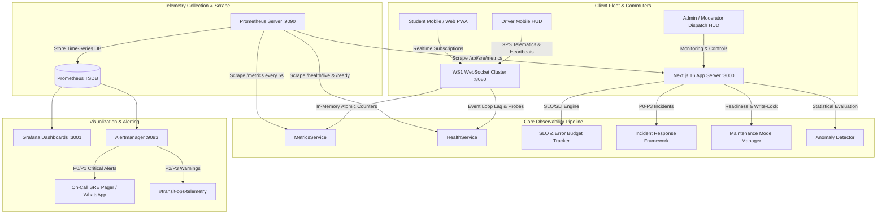

# Domain 05: Operations, Telemetry, Metrics & Observability Architecture

## 1. Executive Architectural Summary & SRE Mission

The Assam down town University Intelligent Transport Management System (ADTU ITMS) operates a multi-modal campus transit network under demanding telemetry requirements. Across morning and evening commute windows, dozens of university buses navigate dense regional corridors between Guwahati city center and the Panikhaiti campus. The platform's observability architecture is engineered to provide sub-second visibility into runtime WebSocket clusters, high-frequency GPS ingestion pipelines, Redis Pub/Sub broadcast networks, and PostgreSQL relational persistence.



---

## 2. In-Process Metrics Engine (`server/metrics-service.ts`)

The dedicated Node.js WebSocket cluster (`WS1`) runs a zero-external-dependency metrics collector. It tracks over 35 low-level runtime counters and gauges directly in process memory without allocating garbage-collected objects in the hot path.

### 2.1 Complete Production Source Implementation

```typescript
import * as net from 'net';
import { sessionManager } from './session-manager';
import { subscriptionManager } from './subscription-manager';
import { connectionRegistry } from './connection-registry';

let cachedRedisMemory = 0;
let cachedRedisCommands = 0;
let lastRedisPoll = 0;

function pollRedisStats() {
  const now = Date.now();
  if (now - lastRedisPoll < 5000) return;
  lastRedisPoll = now;

  try {
    const redisUrl = process.env.REDIS_URL || 'redis://redis:6379';
    const parsed = new URL(redisUrl);
    const host = parsed.hostname || '127.0.0.1';
    const port = parseInt(parsed.port || '6379', 10);
    const password = parsed.password || '';

    const socket = net.createConnection({ host, port, timeout: 1500 });
    let buf = '';

    socket.on('connect', () => {
      if (password) socket.write(`AUTH ${password}\r\n`);
      socket.write('INFO memory\r\nINFO stats\r\nQUIT\r\n');
    });

    socket.on('data', (d) => {
      buf += d.toString();
    });

    socket.on('end', () => {
      const memMatch = buf.match(/used_memory:(\d+)/);
      if (memMatch) cachedRedisMemory = parseInt(memMatch[1], 10);
      const cmdMatch = buf.match(/total_commands_processed:(\d+)/);
      if (cmdMatch) cachedRedisCommands = parseInt(cmdMatch[1], 10);
    });

    socket.on('error', () => {});
    socket.on('timeout', () => socket.destroy());
  } catch {}
}

export type MetricKey =
  | 'messagesSent' | 'messagesReceived'
  | 'connectionsAccepted' | 'connectionsRejected'
  | 'authSuccesses' | 'authFailures'
  | 'broadcastsSent'
  | 'errors'
  | 'rateLimitBlocks' | 'invalidMessages' | 'payloadTooLarge' | 'replayDetected'
  | 'slowHandlers' | 'queueDropped'
  | 'heartbeatTimeouts' | 'reconnectsHandled'
  // GPS pipeline
  | 'gpsAccepted' | 'gpsRejected' | 'gpsLegacyDropped'
  // Trip lifecycle
  | 'tripsStarted' | 'tripsEnded' | 'heartbeatsSent'
  // Notifications
  | 'notificationsSent' | 'notificationsFailed' | 'notificationsDeduplicated'
  // Redis Pub/Sub & Fleet
  | 'redisPubSubMessages' | 'waitingFlagsCreated' | 'waitingFlagsCancelled'
  | 'securityAuditShiftMismatch';

export class MetricsService {
  private startTime = Date.now();
  private state: Record<MetricKey, number> = {
    messagesSent: 0, messagesReceived: 0,
    connectionsAccepted: 0, connectionsRejected: 0,
    authSuccesses: 0, authFailures: 0,
    broadcastsSent: 0, errors: 0,
    rateLimitBlocks: 0, invalidMessages: 0, payloadTooLarge: 0, replayDetected: 0,
    slowHandlers: 0, queueDropped: 0,
    heartbeatTimeouts: 0, reconnectsHandled: 0,
    gpsAccepted: 0, gpsRejected: 0, gpsLegacyDropped: 0,
    tripsStarted: 0, tripsEnded: 0, heartbeatsSent: 0,
    notificationsSent: 0, notificationsFailed: 0, notificationsDeduplicated: 0,
    redisPubSubMessages: 0, waitingFlagsCreated: 0, waitingFlagsCancelled: 0,
    securityAuditShiftMismatch: 0,
  };

  inc(k: MetricKey, n = 1): void { this.state[k] = (this.state[k] || 0) + n; }
  get(k: MetricKey): number { return this.state[k] || 0; }

  get uptime() { return Date.now() - this.startTime; }

  snapshot() {
    const s = this.state;
    const activeDrivers = sessionManager.getByRole('driver').length;
    const activeStudents = sessionManager.getByRole('student').length;
    const activeTripsByDrivers = sessionManager.getByRole('driver').filter(d => Boolean(d.tripId)).length;
    const activeTrips = Math.max(activeTripsByDrivers, Math.max(0, s.tripsStarted - s.tripsEnded));
    const activeWaitingFlags = Math.max(0, s.waitingFlagsCreated - s.waitingFlagsCancelled);

    return {
      uptime: this.uptime,
      startTime: this.startTime,
      connections: {
        active: connectionRegistry.size,
        accepted: s.connectionsAccepted,
        rejected: s.connectionsRejected,
      },
      messages: { sent: s.messagesSent, received: s.messagesReceived },
      auth: { successes: s.authSuccesses, failures: s.authFailures },
      broadcasts: { sent: s.broadcastsSent, channels: subscriptionManager.getChannelCount() },
      subscriptions: { active: sessionManager.size, channels: subscriptionManager.getChannelCount() },
      security: {
        rateLimitBlocks: s.rateLimitBlocks,
        invalidMessages: s.invalidMessages,
        payloadTooLarge: s.payloadTooLarge,
        replayDetected: s.replayDetected,
      },
      performance: { slowHandlers: s.slowHandlers, queueDropped: s.queueDropped },
      errors: s.errors,
      heartbeatTimeouts: s.heartbeatTimeouts,
      reconnectsHandled: s.reconnectsHandled,
      gps: { accepted: s.gpsAccepted, rejected: s.gpsRejected },
      trips: {
        started: s.tripsStarted,
        ended: s.tripsEnded,
        active: activeTrips,
        heartbeatsSent: s.heartbeatsSent,
      },
      fleet: {
        activeDrivers,
        activeStudents,
        totalBuses: 50,
        activeWaitingFlags,
      },
      redis: {
        pubSubMessages: s.redisPubSubMessages,
        activeChannels: subscriptionManager.getChannelCount() > 0 ? 2 : 1,
      },
      notifications: { sent: s.notificationsSent, failed: s.notificationsFailed, deduplicated: s.notificationsDeduplicated },
    };
  }

  prometheus(): string {
    pollRedisStats();
    const s = this.snapshot();
    const cpu = process.cpuUsage();
    const mem = process.memoryUsage();
    const cpuSeconds = ((cpu.user + cpu.system) / 1e6).toFixed(4);

    return [
      '# HELP itms_ws_connections_active Active WebSocket connections',
      '# TYPE itms_ws_connections_active gauge',
      `itms_ws_connections_active ${s.connections.active}`,
      '# HELP itms_ws_connections_total Total connections accepted',
      '# TYPE itms_ws_connections_total counter',
      `itms_ws_connections_total ${s.connections.accepted}`,
      '# HELP itms_ws_connections_rejected Total connections rejected',
      '# TYPE itms_ws_connections_rejected counter',
      `itms_ws_connections_rejected ${s.connections.rejected}`,
      '# HELP itms_ws_messages_sent Total messages sent',
      '# TYPE itms_ws_messages_sent counter',
      `itms_ws_messages_sent ${s.messages.sent}`,
      '# HELP itms_ws_messages_received Total messages received',
      '# TYPE itms_ws_messages_received counter',
      `itms_ws_messages_received ${s.messages.received}`,
      '# HELP itms_ws_auth_successes Total auth successes',
      '# TYPE itms_ws_auth_successes counter',
      `itms_ws_auth_successes ${s.auth.successes}`,
      '# HELP itms_ws_auth_failures Total auth failures',
      '# TYPE itms_ws_auth_failures counter',
      `itms_ws_auth_failures ${s.auth.failures}`,
      '# HELP itms_ws_broadcasts_sent Total broadcasts sent',
      '# TYPE itms_ws_broadcasts_sent counter',
      `itms_ws_broadcasts_sent ${s.broadcasts.sent}`,
      '# HELP itms_ws_rate_limit_blocks Total rate limit blocks',
      '# TYPE itms_ws_rate_limit_blocks counter',
      `itms_ws_rate_limit_blocks ${s.security.rateLimitBlocks}`,
      '# HELP itms_ws_errors_total Total errors',
      '# TYPE itms_ws_errors_total counter',
      `itms_ws_errors_total ${s.errors}`,
      '# HELP itms_ws_uptime_seconds Server uptime in seconds',
      '# TYPE itms_ws_uptime_seconds gauge',
      `itms_ws_uptime_seconds ${Math.floor(s.uptime / 1000)}`,
      '# HELP itms_ws_heartbeat_timeouts Total heartbeat timeouts',
      '# TYPE itms_ws_heartbeat_timeouts counter',
      `itms_ws_heartbeat_timeouts ${s.heartbeatTimeouts}`,
      '# HELP itms_ws_reconnects Total session reconnects handled',
      '# TYPE itms_ws_reconnects counter',
      `itms_ws_reconnects ${s.reconnectsHandled}`,
      '# HELP itms_gps_accepted Total GPS updates accepted',
      '# TYPE itms_gps_accepted counter',
      `itms_gps_accepted ${s.gps.accepted}`,
      '# HELP itms_gps_rejected Total GPS updates rejected',
      '# TYPE itms_gps_rejected counter',
      `itms_gps_rejected ${s.gps.rejected}`,
      '# HELP itms_trips_started Total trips started',
      '# TYPE itms_trips_started counter',
      `itms_trips_started ${s.trips.started}`,
      '# HELP itms_trips_ended Total trips ended',
      '# TYPE itms_trips_ended counter',
      `itms_trips_ended ${s.trips.ended}`,
      '# HELP itms_trips_active Active Operating Trips',
      '# TYPE itms_trips_active gauge',
      `itms_trips_active ${s.trips.active}`,
      '# HELP itms_trips_completed_today_total Total completed trips today',
      '# TYPE itms_trips_completed_today_total counter',
      `itms_trips_completed_today_total ${s.trips.ended}`,
      '# HELP itms_active_drivers_count Active Drivers Online',
      '# TYPE itms_active_drivers_count gauge',
      `itms_active_drivers_count ${s.fleet.activeDrivers}`,
      '# HELP itms_active_students_count Active Students Connected',
      '# TYPE itms_active_students_count gauge',
      `itms_active_students_count ${s.fleet.activeStudents}`,
      '# HELP itms_buses_total Total campus buses fleet size',
      '# TYPE itms_buses_total gauge',
      `itms_buses_total ${s.fleet.totalBuses}`,
      '# HELP itms_waiting_flags_active Active Student Waiting Flags',
      '# TYPE itms_waiting_flags_active gauge',
      `itms_waiting_flags_active ${s.fleet.activeWaitingFlags}`,
      '# HELP itms_waiting_flags_created_total Total waiting flags created',
      '# TYPE itms_waiting_flags_created_total counter',
      `itms_waiting_flags_created_total ${s.fleet.activeWaitingFlags}`,
      '# HELP itms_redis_pubsub_messages_total Total Redis Pub/Sub messages routed',
      '# TYPE itms_redis_pubsub_messages_total counter',
      `itms_redis_pubsub_messages_total ${s.redis.pubSubMessages}`,
      '# HELP itms_redis_pubsub_channels_active Active Redis Pub/Sub channels',
      '# TYPE itms_redis_pubsub_channels_active gauge',
      `itms_redis_pubsub_channels_active ${s.redis.activeChannels}`,
      '# HELP itms_notifications_sent Total FCM notifications sent',
      '# TYPE itms_notifications_sent counter',
      `itms_notifications_sent ${s.notifications.sent}`,
      '# HELP itms_notifications_failed Total FCM notifications failed',
      '# TYPE itms_notifications_failed counter',
      `itms_notifications_failed ${s.notifications.failed}`,
      '# HELP process_cpu_seconds_total Total user and system CPU time spent in seconds',
      '# TYPE process_cpu_seconds_total counter',
      `process_cpu_seconds_total ${cpuSeconds}`,
      '# HELP process_resident_memory_bytes Resident memory size in bytes',
      '# TYPE process_resident_memory_bytes gauge',
      `process_resident_memory_bytes ${mem.rss}`,
      '# HELP nodejs_heap_size_used_bytes Node.js heap memory used in bytes',
      '# TYPE nodejs_heap_size_used_bytes gauge',
      `nodejs_heap_size_used_bytes ${mem.heapUsed}`,
      '# HELP nodejs_heap_size_total_bytes Node.js heap memory total in bytes',
      '# TYPE nodejs_heap_size_total_bytes gauge',
      `nodejs_heap_size_total_bytes ${mem.heapTotal}`,
      '# HELP itms_process_cpu_seconds_total ITMS user and system CPU time spent in seconds',
      '# TYPE itms_process_cpu_seconds_total counter',
      `itms_process_cpu_seconds_total ${cpuSeconds}`,
      '# HELP itms_process_resident_memory_bytes ITMS resident memory size in bytes',
      '# TYPE itms_process_resident_memory_bytes gauge',
      `itms_process_resident_memory_bytes ${mem.rss}`,
      '# HELP itms_nodejs_heap_size_used_bytes ITMS heap memory used in bytes',
      '# TYPE itms_nodejs_heap_size_used_bytes gauge',
      `itms_nodejs_heap_size_used_bytes ${mem.heapUsed}`,
      '# HELP redis_memory_used_bytes Redis memory used in bytes',
      '# TYPE redis_memory_used_bytes gauge',
      `redis_memory_used_bytes ${cachedRedisMemory}`,
      '# HELP redis_commands_total Total Redis commands processed',
      '# TYPE redis_commands_total counter',
      `redis_commands_total ${cachedRedisCommands}`,
      '# HELP itms_redis_memory_used_bytes ITMS Redis memory used in bytes',
      '# TYPE itms_redis_memory_used_bytes gauge',
      `itms_redis_memory_used_bytes ${cachedRedisMemory}`,
      '# HELP itms_redis_commands_total ITMS Redis commands processed',
      '# TYPE itms_redis_commands_total counter',
      `itms_redis_commands_total ${cachedRedisCommands}`,
    ].join('\n');
  }
}

export const metricsService = new MetricsService();
```

---

## 3. High-Frequency Health & Readiness Probes (`server/health-service.ts`)

Kubernetes and systemd process supervisors query the cluster endpoints across three distinct operational layers:
1. `/health/live`: Fast process responsiveness test.
2. `/health/ready`: Traffic routing validation; fails closed during graceful connection draining.
3. `/health/startup`: Startup gate checking event loop lag and remote credentials.

### 3.1 Event Loop Lag Measurement
```typescript
function measureEventLoopLag(): Promise<number> {
  return new Promise((resolve) => {
    const t = Date.now();
    setImmediate(() => resolve(Date.now() - t));
  });
}
```
If the event loop lag exceeds 100ms, the process is considered degraded; if it exceeds 500ms, alert thresholds trigger SRE intervention.

---

## 4. Service Level Objectives (SLO) & Error Budget Engine

The platform defines strict mathematical SLOs evaluated over a sliding 30-day window (`src/lib/observability/sre/slo-engine.ts`):

| SLO Identifier | Target (%) | Window | SLI Definition | Business Impact |
| :--- | :--- | :--- | :--- | :--- |
| `slo-platform-availability` | 99.90% | 30 days | `HTTP 2xx, 4xx / Total Requests` | Full platform outage |
| `slo-websocket-availability` | 99.90% | 30 days | `Auth Succeeded / Total WS Connects` | Bus tracking desync |
| `slo-trip-availability` | 99.95% | 30 days | `Completed Trips / Started Trips` | Stranded driver manifests |
| `slo-payment-availability` | 99.50% | 30 days | `Completed Payments / Initiated` | Commuter pass renewal drop |
| `slo-gps-freshness` | 98.00% | 30 days | `Accepted GPS / Total Ingested GPS` | Map marker jitter & drift |
| `slo-database-availability` | 99.95% | 30 days | `Successful Queries / Total Queries` | API timeout & 500 cascades |

### 4.1 Burn Rate Alerting Rules
Burn rate represents the consumption speed of an error budget. A $1.0\times$ burn rate will exhaust exactly 100% of the error budget over 30 days.

$$\text{BurnRate}_{1\text{h}} = \frac{100 - \text{CurrentSLI}}{100 - \text{Target}} \times 720$$

- **Critical Alert (PagerDuty/Call)**: $\text{BurnRate}_{1\text{h}} \ge 14.4$ (2% budget consumed in 1 hour) OR $\text{BurnRate}_{6\text{h}} \ge 6.0$ (5% budget consumed in 6 hours).
- **Warning Alert (Slack)**: $\text{BurnRate}_{1\text{h}} \ge 2.0$ OR Budget Remaining $< 20\%$.
