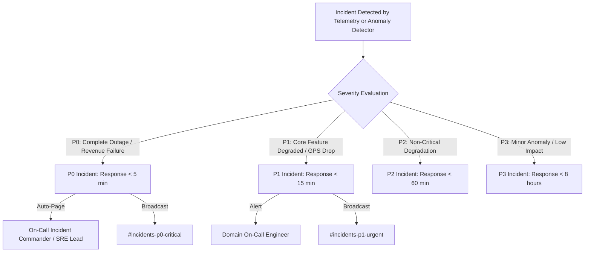

# Domain 05: Operational Incident Runbooks & SRE Escalation Protocols

## 1. Incident Classification & Escalation Matrix

The ITMS SRE framework (`src/lib/observability/sre/incident-framework.ts`) implements a 4-tier severity system with deterministic escalation targets:



| Severity | Target Response | Primary Role | Secondary Role | Channel | Notification |
| :--- | :--- | :--- | :--- | :--- | :--- |
| **P0** | **5 minutes** | On-Call Incident Commander | Principal Systems Architect | `#incidents-p0-critical` | Executive Leadership Paged |
| **P1** | **15 minutes** | Domain On-Call Engineer | Platform Engineering Lead | `#incidents-p1-urgent` | Leadership Notified |
| **P2** | **60 minutes** | Domain Technical Lead | Senior Software Engineer | `#alerts-ops` | Team Channel |
| **P3** | **480 minutes** | Maintenance Engineer | Service Owner | `#alerts-info` | Daily Digest |

---

## 2. Standard Operating Runbooks (SRE-01 to SRE-06)

### SRE-01: Stranded Driver Trip Lock / Ghost Lock Recovery
**Symptoms**: Driver cannot start their assigned morning or evening route. Terminal or mobile UI displays `TRIP_ALREADY_ACTIVE` or `RESOURCE_LOCKED`, but the driver has no active trip running.
**Root Cause**: Node.js crash during trip termination or Redis key expiry mismatch leaving row in `active_trips` with `status = 'IN_TRANSIT'`.
**Remediation Steps**:
1. Identify the affected driver ID and vehicle ID:
   ```bash
   curl -s -H "Authorization: Bearer $SUPERADMIN_TOKEN" \
     "https://transit.adtu.edu.in/api/admin/active-trips?driverId=DRV_0192"
   ```
2. Check PostgreSQL active trips lock:
   ```sql
   SELECT id, bus_id, driver_id, route_id, status, started_at, updated_at
   FROM active_trips
   WHERE driver_id = '01920000-0000-0000-0000-000000000000'
     AND status = 'IN_TRANSIT';
   ```
3. Execute atomic trip termination via administrative RPC:
   ```sql
   SELECT end_trip_atomically(
     'TRIP_UUID_HERE',
     'FORCE_TERMINATED_SRE',
     'Manual SRE clearance of stranded trip lock'
   );
   ```
4. Clear ephemeral Redis driver session and pub/sub cache:
   ```bash
   redis-cli DEL "trip:lock:driver:DRV_0192"
   redis-cli DEL "trip:lock:bus:BUS_12"
   redis-cli PUBLISH "trip:events" '{"type":"TRIP_FORCE_ENDED","tripId":"TRIP_UUID_HERE"}'
   ```
5. Verify driver can immediately initiate their route.

---

### SRE-02: Redis Outage & Failover Recovery
**Symptoms**: `itms_redis_pubsub_messages_total` stops incrementing. WebSocket cluster logs `ECONNREFUSED 6379`. Map markers freeze on student interfaces.
**Root Cause**: Redis container OOM-killed, volume corruption, or network isolation.
**Remediation Steps**:
1. Check Redis container health on host:
   ```bash
   docker ps -a --filter "name=redis"
   docker logs --tail 100 itms-redis
   ```
2. If Redis exited with code 137 (OOM):
   - Inspect memory limits in `docker-compose.yml`.
   - Start Redis with maxmemory eviction policy:
     ```bash
     redis-server --maxmemory 512mb --maxmemory-policy allkeys-lru --appendonly yes
     ```
3. Restart WebSocket cluster connection pool:
   ```bash
   systemctl restart itms-websocket-cluster
   ```
4. Verify `/health/ready` returns `status: "ok"` and `dependencies.redis: "ok"`.

---

### SRE-03: Ghost Bus Marker & Client Map Desync
**Symptoms**: A bus appears stationary on student maps for $>10$ minutes while the physical bus has already departed or completed the route.
**Root Cause**: Driver application terminated without clean WebSocket close frame; Redis persistence throttle did not write `completed` status before disconnect.
**Remediation Steps**:
1. Query active trips vs last telematics timestamp:
   ```sql
   SELECT t.id, t.bus_id, t.started_at,
          NOW() - MAX(g.created_at) AS telematics_silence_duration
   FROM active_trips t
   LEFT JOIN gps_logs g ON g.trip_id = t.id
   WHERE t.status = 'IN_TRANSIT'
   GROUP BY t.id, t.bus_id, t.started_at
   HAVING NOW() - MAX(g.created_at) > INTERVAL '5 minutes';
   ```
2. Trigger the automated stale trip sweep:
   ```bash
   npm run cron:cleanup-stale-trips
   ```
3. Evict stale runtime bus state from Redis:
   ```bash
   redis-cli HDEL "buses:active" "BUS_14"
   redis-cli PUBLISH "route:ROUTE_04" '{"type":"BUS_EVICTED","busId":"BUS_14"}'
   ```

---

### SRE-04: Razorpay Webhook Drop & Pass Activation Failure
**Symptoms**: Student account charged INR 14,000, but transit pass remains inactive (`PAYMENT_PENDING`).
**Root Cause**: Razorpay webhook delivery retry exhausted due to cloud flare rate limiting or network latency spike.
**Remediation Steps**:
1. Query Razorpay API using payment reference:
   ```bash
   curl -u "$RAZORPAY_KEY_ID:$RAZORPAY_SECRET" \
     "https://api.razorpay.com/v1/payments/pay_P10982390823"
   ```
2. Verify payment status is `captured` and `amount` matches active semester fee.
3. Execute atomic manual reconciliation RPC in PostgreSQL:
   ```sql
   SELECT reconcile_offline_payment_v1(
     p_student_id => 'STU_99482',
     p_payment_reference => 'pay_P10982390823',
     p_amount => 14000.00,
     p_reconciled_by => 'SRE_LEAD'
   );
   ```
4. Verify student transit pass is generated with valid QR token.

---

### SRE-05: Database Connection Pool Exhaustion
**Symptoms**: HTTP 500 spike across all Next.js API routes with message `sorry, too many clients already`.
**Root Cause**: Unclosed database connections in serverless API routes or long-running unindexed analytics queries holding pool locks.
**Remediation Steps**:
1. Inspect active PostgreSQL backends:
   ```sql
   SELECT pid, usename, client_addr, state, query_start, query
   FROM pg_stat_activity
   WHERE state != 'idle'
   ORDER BY query_start ASC;
   ```
2. Terminate long-running blocking queries ($>30$ seconds):
   ```sql
   SELECT pg_terminate_backend(pid)
   FROM pg_stat_activity
   WHERE state != 'idle'
     AND query_start < NOW() - INTERVAL '30 seconds'
     AND pid <> pg_backend_pid();
   ```
3. Verify connection pooler (PgBouncer/Supabase Pooler) is healthy on port 6543.

---

### SRE-06: Maintenance Mode Activation
To gracefully drain connections and block mutations during emergency schema updates or hotfix deployments:
```bash
# Enable Maintenance Mode with 30-minute estimate
curl -X POST https://transit.adtu.edu.in/api/admin/maintenance \
  -H "Authorization: Bearer $SUPERADMIN_TOKEN" \
  -H "Content-Type: application/json" \
  -d '{"reason":"Emergency Database Migration","durationMinutes":30,"readOnly":true}'
```
This drops the `.maintenance-active` sentinel file on disk, shifts `/health/ready` to `down` (draining ingress load balancers), and renders read-only banners to all client applications.
