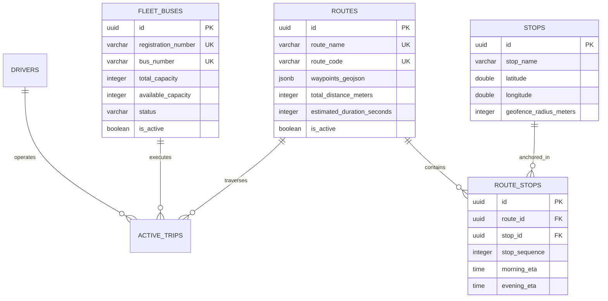

# Domain 05: Fleet Operations, Route Topology & Mutation Safety Guards

## 1. Relational Fleet & Route Schema Architecture

The fleet and route management subsystem provides the authoritative spatial and structural definitions of vehicles, stops, and corridors.



---

## 2. Invariant Mutation Safety Guards

### 2.1 `INV-FLEET-001`: Active Trip Fleet Mutation Lockout
A bus currently operating an active trip (`status = 'IN_TRANSIT'`) cannot have its capacity, registration plate, route assignment, or maintenance status modified. Any incoming PATCH or DELETE request must be rejected immediately with HTTP 409 Conflict.

```sql
CREATE OR REPLACE FUNCTION guard_bus_mutation_during_active_trip()
RETURNS TRIGGER AS $$
BEGIN
  IF EXISTS (
    SELECT 1 FROM active_trips
    WHERE bus_id = OLD.id AND status = 'IN_TRANSIT'
  ) THEN
    RAISE EXCEPTION 'INV-FLEET-001: Cannot modify fleet bus % while participating in an active trip', OLD.bus_number
      USING ERRCODE = 'P0001';
  END IF;
  RETURN NEW;
END;
$$ LANGUAGE plpgsql;

CREATE TRIGGER trg_guard_bus_mutation
BEFORE UPDATE OR DELETE ON fleet_buses
FOR EACH ROW
EXECUTE FUNCTION guard_bus_mutation_during_active_trip();
```

### 2.2 `INV-FLEET-002`: Seat Capacity Floor Constraint
A bus's `total_capacity` cannot be down-scaled below the number of active student seat allocations assigned to that vehicle across active shifts:

```sql
CREATE OR REPLACE FUNCTION guard_bus_capacity_downscaling()
RETURNS TRIGGER AS $$
DECLARE
  v_allocated_count INTEGER;
BEGIN
  IF NEW.total_capacity < OLD.total_capacity THEN
    SELECT COUNT(*) INTO v_allocated_count
    FROM student_profiles
    WHERE assigned_bus_id = OLD.id AND is_active = true;

    IF NEW.total_capacity < v_allocated_count THEN
      RAISE EXCEPTION 'INV-FLEET-002: Cannot reduce bus capacity to %; % students currently allocated',
        NEW.total_capacity, v_allocated_count
        USING ERRCODE = 'P0002';
    END IF;
  END IF;
  RETURN NEW;
END;
$$ LANGUAGE plpgsql;

CREATE TRIGGER trg_guard_bus_capacity_downscale
BEFORE UPDATE OF total_capacity ON fleet_buses
FOR EACH ROW
EXECUTE FUNCTION guard_bus_capacity_downscaling();
```

---

## 3. Spatial Route Topology & Geofence Specifications

Each transit stop is anchored by precise spatial coordinates and dual-concentric geofences:
- **Inner Entry Geofence (80 meters)**: Bus entry triggers stop arrival timestamp (`arrived_at`) and activates hands-free driver HUD dwell countdown.
- **Outer Exit Geofence (100 meters)**: Bus departure beyond this hysteresis boundary calculates `dwell_seconds = EXTRACT(EPOCH FROM (NOW() - arrived_at))` and publishes stop departure evidence.
