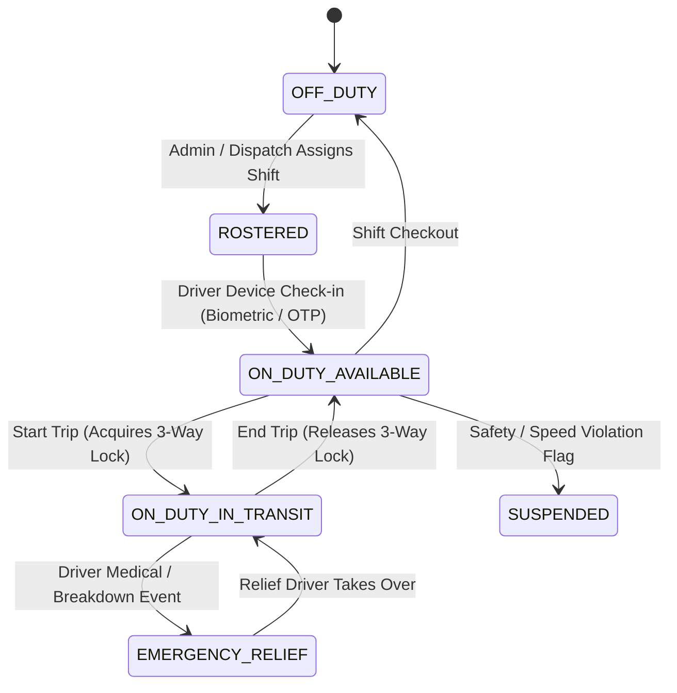
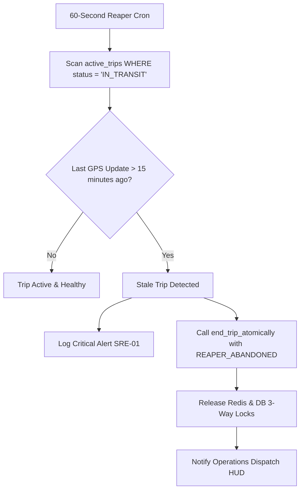

# Domain 05: Driver Rosters, Duty Transitions & Stale Lock Reaper

## 1. Driver Duty Lifecycle State Machine

Driver duty states are strictly governed to prevent concurrent assignments, unauthorized operation, and fatigue violations.



---

## 2. Single-Device Session Locking (`device_sessions`)

To prevent multiple physical phones from impersonating the same driver or broadcasting conflicting GPS streams, the platform enforces single-device session locking:

1. When a driver logs in, client transmits hardware device UUID and push token.
2. The authentication service updates `device_sessions`:
   ```sql
   INSERT INTO device_sessions (user_id, device_id, platform, push_token, last_active_at)
   VALUES (p_user_id, p_device_id, p_platform, p_push_token, NOW())
   ON CONFLICT (user_id) DO UPDATE SET
     device_id = EXCLUDED.device_id,
     push_token = EXCLUDED.push_token,
     last_active_at = NOW();
   ```
3. Any prior active WebSocket connection for that user ID receives close code `4401: SESSION_SUPERSEDED`.

---

## 3. Parallel Stale Lock Reaper Architecture

In high-concurrency transit environments, client mobile phones may lose cellular signal, run out of battery, or terminate abruptly in road dead zones. The background stale lock reaper runs every 60 seconds to detect and evict abandoned locks:



### 3.1 Reaper Execution Query
```sql
SELECT t.id, t.bus_id, t.driver_id, t.route_id, MAX(g.created_at) AS last_telematics
FROM active_trips t
JOIN gps_logs g ON g.trip_id = t.id
WHERE t.status = 'IN_TRANSIT'
GROUP BY t.id, t.bus_id, t.driver_id, t.route_id
HAVING MAX(g.created_at) < NOW() - INTERVAL '15 minutes';
```
