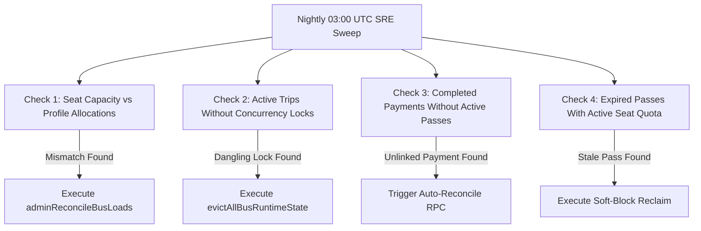

# Domain 05: Automated Integrity Sweep & Self-Healing Seat Reconciler

## 1. Nightly Diagnostic Integrity Sweep Architecture

At 03:00 UTC daily, the SRE integrity sweep executes a comprehensive audit across all 15 system domains to guarantee zero silent drift between relational state, ledger entries, and cached projections.



---

## 2. Self-Healing Bus Seat Reconciler (`adminReconcileBusLoads`)

If race conditions or manual administrative overrides cause a bus's `available_capacity` to drift from actual assigned passenger counts, the reconciler recomputes and locks ground truth atomically:

```sql
CREATE OR REPLACE FUNCTION reconcile_bus_seat_loads_v1()
RETURNS TABLE (
  bus_id UUID,
  bus_number VARCHAR,
  total_capacity INTEGER,
  old_available INTEGER,
  new_available INTEGER,
  reconciled_delta INTEGER
) AS $$
BEGIN
  RETURN QUERY
  WITH actual_allocations AS (
    SELECT
      b.id AS b_id,
      b.bus_number AS b_num,
      b.total_capacity AS b_total,
      b.available_capacity AS b_old_avail,
      COUNT(sp.id) FILTER (WHERE sp.is_active = true) AS b_active_students
    FROM fleet_buses b
    LEFT JOIN student_profiles sp ON sp.assigned_bus_id = b.id
    GROUP BY b.id, b.bus_number, b.total_capacity, b.available_capacity
  ),
  updated_buses AS (
    UPDATE fleet_buses fb
    SET available_capacity = GREATEST(0, aa.b_total - aa.b_active_students)
    FROM actual_allocations aa
    WHERE fb.id = aa.b_id
      AND fb.available_capacity <> GREATEST(0, aa.b_total - aa.b_active_students)
    RETURNING fb.id, aa.b_num, aa.b_total, aa.b_old_avail, fb.available_capacity
  )
  SELECT
    ub.id,
    ub.b_num,
    ub.b_total,
    ub.b_old_avail,
    ub.available_capacity,
    (ub.available_capacity - ub.b_old_avail) AS reconciled_delta
  FROM updated_buses ub;
END;
$$ LANGUAGE plpgsql SECURITY DEFINER;
```

---

## 3. Tier B Audit Event Pipeline (`audit_events`)

All administrative mutations, security overrides, and system-level reconciliations are recorded in an append-only, tamper-resistant audit table:

```sql
CREATE TABLE audit_events (
  id UUID PRIMARY KEY DEFAULT gen_random_uuid(),
  event_type VARCHAR(64) NOT NULL,
  actor_id UUID REFERENCES auth.users(id),
  actor_role VARCHAR(32) NOT NULL,
  entity_type VARCHAR(64) NOT NULL,
  entity_id VARCHAR(64) NOT NULL,
  old_state JSONB,
  new_state JSONB,
  ip_address INET,
  user_agent TEXT,
  created_at TIMESTAMPTZ NOT NULL DEFAULT NOW()
);

-- Immutability Rule: No updates or deletes allowed on audit logs
CREATE OR REPLACE FUNCTION prevent_audit_tampering()
RETURNS TRIGGER AS $$
BEGIN
  RAISE EXCEPTION 'INV-AUDIT-001: Audit log entries are strictly immutable'
    USING ERRCODE = 'P0003';
END;
$$ LANGUAGE plpgsql;

CREATE TRIGGER trg_protect_audit_events
BEFORE UPDATE OR DELETE ON audit_events
FOR EACH ROW
EXECUTE FUNCTION prevent_audit_tampering();
```
