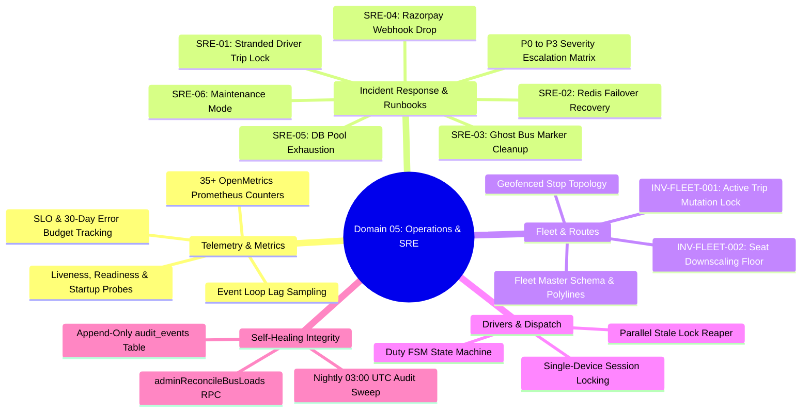

# Domain 05: Operations, Runbooks & System Observability

## Executive Overview
Domain 05 defines the operational backbone, site reliability engineering (SRE) frameworks, metrics collection, and disaster recovery procedures for the Assam down town University Intelligent Transport Management System (ADTU ITMS).

## Forensic Document Roadmap

| Document | Focus & Key Implementation |
| :--- | :--- |
| [01-telemetry-and-metrics.md](file:///c:/Users/ADMIN/Desktop/Projects/ITMS/docs/05-operations-and-observability/01-telemetry-and-metrics.md) | OpenMetrics export, `MetricsService`, `HealthService`, Prometheus scrape config, Grafana alerts, SRE SLO catalog. |
| [02-incident-runbooks.md](file:///c:/Users/ADMIN/Desktop/Projects/ITMS/docs/05-operations-and-observability/02-incident-runbooks.md) | SRE runbooks SRE-01 through SRE-06, P0-P3 escalation matrix, maintenance mode activation. |
| [03-fleet-and-route-operations.md](file:///c:/Users/ADMIN/Desktop/Projects/ITMS/docs/05-operations-and-observability/03-fleet-and-route-operations.md) | Fleet master schema, route waypoints, geofences, mutation safety guards `INV-FLEET-001` and `INV-FLEET-002`. |
| [04-driver-rosters-and-dispatch.md](file:///c:/Users/ADMIN/Desktop/Projects/ITMS/docs/05-operations-and-observability/04-driver-rosters-and-dispatch.md) | Driver duty state machine, single-device session locks, relief pool, 60s parallel stale lock reaper. |
| [05-integrity-sweep-and-reconciliation.md](file:///c:/Users/ADMIN/Desktop/Projects/ITMS/docs/05-operations-and-observability/05-integrity-sweep-and-reconciliation.md) | Nightly diagnostic sweep, `reconcile_bus_seat_loads_v1` self-healing RPC, append-only immutable audit logging. |
