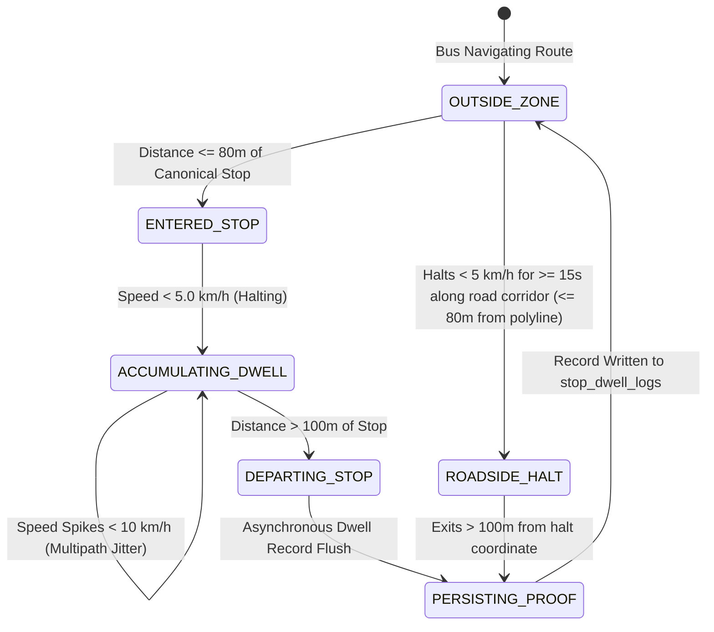

# Domain 07: Incontrovertible Stop Dwell Audit Proof & Hands-Free Waiting Flags

## 1. Executive Summary & Legal Transit Proof Mandate

Student commuters and university drivers frequently encounter disputes regarding missed bus pickups, contested arrival times, and allegations of buses leaving stops ahead of schedule. The ADTU ITMS Stop Dwell Audit Proof Engine (`src/domains/gps/services/stop-dwell.service.ts`) establishes an **incontrovertible, immutable spatial record** (`public.stop_dwell_logs`) every time a bus approaches, halts at, and departs from an assigned route stop or roadside boarding corridor.



---

## 2. Geofence Hysteresis & Continuous Zone Residency

A naive geofence with a single threshold (e.g. 80m) causes rapid "flutter" if a bus halts on the perimeter line, generating dozens of fragmented entry and exit logs.

The ITMS audit engine implements dual-concentric geofence hysteresis:
- **Inner Entry Threshold ($80\text{ meters}$)**: When Haversine distance between bus and stop center $\le 80\text{m}$, an active dwell state is instantiated with `arrived_at = NOW()` and `dwell_seconds = 0`.
- **Outer Exit Threshold ($100\text{ meters}$)**: The dwell state remains continuously active until the bus moves $> 100\text{m}$ away from the stop. This $20\text{m}$ buffer completely absorbs GNSS signal drift while the vehicle is stationary.

### 2.1 Multipath Speed Jitter Resilience (`Math.max`)
Consumer smartphones inside bus windshields experience multipath reflections from metal bus bodies and concrete bus shelters, causing instantaneous reported GPS speeds to fluctuate between $0\text{ km/h}$ and $8\text{ km/h}$ even when parked.

To prevent genuine stops from logging 0 dwell seconds, the engine calculates:

$$\text{ResidencySeconds} = \max\left(0, \text{round}\left(\frac{\text{lastTickMs} - \text{arrivedAtMs}}{1000}\right)\right)$$
$$\text{EffectiveDwellSeconds} = \max(\text{accumulatedLowSpeedSeconds}, \text{ResidencySeconds})$$

If the bus remained inside the $80\text{m}$ boundary with bounded total displacement, the entire residency duration is awarded as incontrovertible dwell proof.

---

## 3. Hands-Free Waiting Flag Processing (Zero-DB Hot Path)

Student waiting flags alert approaching drivers that commuters are standing at a stop. Querying PostgreSQL on every 2-second driver GPS tick would overload the database connection pool. The engine runs a **zero-DB Redis pipeline**:

1. **Auto-Acknowledgment ($\le 600\text{ meters}$ upstream)**:
   When an approaching bus crosses within $600\text{m}$ along the route corridor, the waiting flag status automatically transitions from `ACTIVE` to `ACKNOWLEDGED`. The driver HUD plays a hands-free auditory chime, and the student app displays *"Bus is approaching your stop (within 600m)"*.
2. **Auto-Dismissal / Pass-By ($> 200\text{ meters}$ downstream)**:
   When the bus passes more than $200\text{m}$ past the stop along the route polyline, the flag automatically transitions to `CLEARED` or `MISSED`, freeing the driver HUD from clutter.
3. **Direction-Aware Progress Symmetry (`INV-GPS-007`)**:
   Corridor projection accounts for Morning (outbound) vs Evening (inbound) route polarities, inverting relative progression math so that upstream vs downstream checks function identically in both directions.

---

## 4. Relational Audit Schema & Immutability Trigger

```sql
CREATE TABLE stop_dwell_logs (
  id UUID PRIMARY KEY DEFAULT gen_random_uuid(),
  trip_id UUID NOT NULL REFERENCES active_trips(id) ON DELETE CASCADE,
  bus_id UUID NOT NULL REFERENCES fleet_buses(id),
  driver_id UUID NOT NULL REFERENCES auth.users(id),
  route_id UUID REFERENCES routes(id),
  stop_id UUID REFERENCES stops(id),
  stop_name VARCHAR(128) NOT NULL,
  arrived_at TIMESTAMPTZ NOT NULL,
  departed_at TIMESTAMPTZ NOT NULL,
  dwell_seconds INTEGER NOT NULL,
  is_roadside BOOLEAN DEFAULT FALSE,
  created_at TIMESTAMPTZ NOT NULL DEFAULT NOW()
);

CREATE INDEX idx_dwell_trip_stop ON stop_dwell_logs(trip_id, stop_id);
CREATE INDEX idx_dwell_bus_time ON stop_dwell_logs(bus_id, arrived_at);

-- Invariant Enforcement: Dwell logs are permanent forensic evidence; NO updates or deletes permitted
CREATE OR REPLACE FUNCTION protect_stop_dwell_logs()
RETURNS TRIGGER AS $$
BEGIN
  RAISE EXCEPTION 'INV-TRIP-006: Stop dwell logs are permanent incontrovertible audit records and cannot be mutated'
    USING ERRCODE = 'P0004';
END;
$$ LANGUAGE plpgsql;

CREATE TRIGGER trg_protect_stop_dwell
BEFORE UPDATE OR DELETE ON stop_dwell_logs
FOR EACH ROW
EXECUTE FUNCTION protect_stop_dwell_logs();
```
