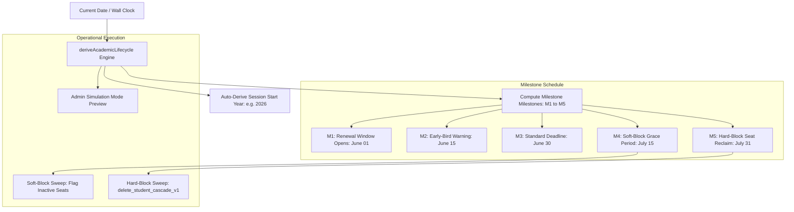

# Domain 08: Dynamic Academic Calendar Engine & Deadline Cascade

## 1. Executive Summary & Calendar Architecture

Assam down town University operates on a multi-semester academic schedule. The ITMS platform relies on the Dynamic Academic Calendar Engine (`src/domains/calendar/` and `src/lib/deadline-config-service.ts`) to calculate annual start years, compute renewal and registration deadlines, handle leap-year normalizations, and drive automated seat-reclaim crons.



---

## 2. Dynamic Start-Year Derivation Algorithm

In university operations, an academic session spans two calendar years (e.g., Session 2026 spans July 2026 to June 2027). The system must never hardcode session years.

### 2.1 Derivation Logic
- **Pre-Cutoff (January 01 – May 31)**: Commute belongs to the spring semester of the preceding academic session. Start year = $\text{CurrentYear} - 1$.
- **Post-Cutoff (June 01 – December 31)**: Commute belongs to the fall semester of the new academic session. Start year = $\text{CurrentYear}$.

```typescript
export function deriveSessionStartYear(referenceDate = new Date()): number {
  const month = referenceDate.getMonth(); // 0-indexed: 0 = Jan, 5 = June
  const fullYear = referenceDate.getFullYear();
  return month < 5 ? fullYear - 1 : fullYear;
}
```

---

## 3. The 5 Milestone Deadlines & Transition Mechanics

The engine automatically constructs ISO date strings for the 5 lifecycle milestones based on university administrative policy:

| Milestone | Target Month & Day | Operational Significance |
| :--- | :--- | :--- |
| **M1: Window Open** | `06-01T00:00:00.000Z` | Registration & renewal wizard opens for student submissions. |
| **M2: Renewal Reminder** | `06-15T00:00:00.000Z` | Automated push notification and WhatsApp broadcast to all active riders. |
| **M3: Standard Deadline** | `06-30T23:59:59.999Z` | Grace period ends; un-renewed riders receive daily urgency banners. |
| **M4: Soft-Block** | `07-15T23:59:59.999Z` | Boarding pass status shifts to `SOFT_BLOCKED`; driver scanners sound warning buzzer. |
| **M5: Hard-Block** | `07-31T23:59:59.999Z` | Seat reclaimed atomically into bus `available_capacity`; profile archived. |

---

## 4. Simulation Mode & Administrator Override

Administrators can test milestone transitions without modifying the system clock using the simulation mode parameter:
```typescript
const simulatedState = deriveAcademicLifecycle({
  overrideDate: '2026-07-16T10:00:00Z',
  customDeadline: '2026-07-05',
});
// Evaluates all riders as SOFT_BLOCKED for dry-run verification
```
