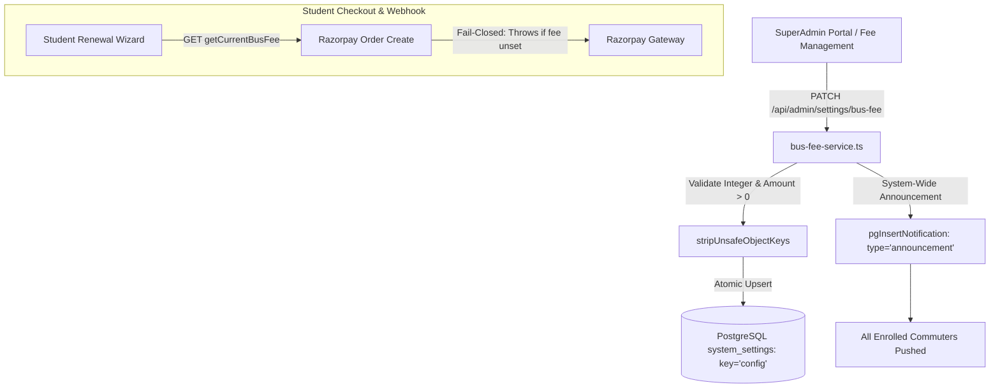

# Domain 08: Bus Fees, Dynamic Pricing & Fail-Closed Financial Configuration

## 1. Executive Summary & Fee Architecture

The Assam down town University bus fee is a strictly governed institutional financial parameter. Unlike commercial transit systems with dynamic surge pricing, university transit fees are fixed per semester or academic session, regulated by university executive committees.

The ITMS platform manages fee configuration through `src/lib/bus-fee-service.ts` and PostgreSQL `public.system_settings`.



---

## 2. Fail-Closed Fee Fetching (`getCurrentBusFee`)

A critical invariant of the financial subsystem is that **the platform must never fall back to hardcoded default prices** (such as INR 10,000 or INR 0) if the database is unreachable or the configuration is missing:

```typescript
export async function getCurrentBusFee(): Promise<BusFeeData> {
  try {
    const systemConfigResult = await getSystemConfig();
    const config = systemConfigResult.data;

    const amount = config.busFee?.amount;

    if (typeof amount !== 'number' || amount <= 0) {
      throw new Error('Bus fee configuration is missing in settings database. Please configure settings and try again later.');
    }

    return {
      amount: amount,
      updatedAt: systemConfigResult.updatedAt || new Date().toISOString(),
      updatedBy: systemConfigResult.updatedByUid || 'system',
      version: config.version || 1
    };
  } catch (error: any) {
    console.error('Error getting current bus fee:', error);
    throw new Error(error.message || 'Unstable network detected, please try again later');
  }
}
```

### 2.1 Security Rationale
If the system fell back to a default value during database instability, students might be charged an outdated or zero amount. Failing closed halts order creation immediately, protecting university revenue and preventing ledger reconciliation disputes.

---

## 3. Automated Institutional Announcement Broadcast

When an administrator updates the bus fee, `notifyBusFeeChange()` automatically constructs an immutable announcement record in `notifications`:

```typescript
export async function notifyBusFeeChange(
  adminUid: string,
  oldAmount: number,
  newAmount: number
): Promise<boolean> {
  const adminData = await getAdminById(adminUid);
  const adminName = adminData?.name || adminData?.fullName || 'Admin';

  const notificationContent = `The bus fee for the upcoming session has been revised from ₹${oldAmount.toLocaleString('en-IN')} to ₹${newAmount.toLocaleString('en-IN')}. ` +
    `Please update your payment plans accordingly. For any queries, contact the administration office.`;

  await pgInsertNotification({
    title: '💰 Bus Fee Update - Important Notice',
    content: notificationContent,
    type: 'announcement',
    sender: {
      userId: adminUid,
      userName: adminName,
      userRole: 'admin',
    },
    target: {
      type: 'all_users',
    },
    recipientIds: [],
    readByUserIds: [],
  });
  return true;
}
```
