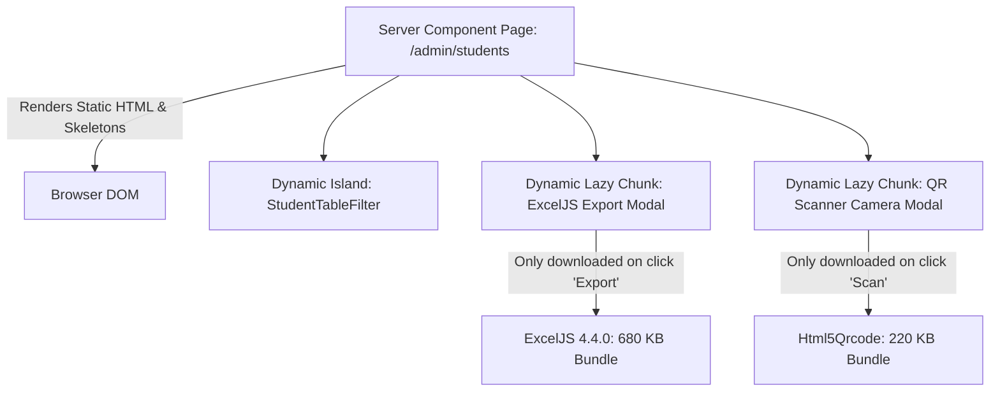

# Domain 10: Component Tree Optimization, Dynamic Splitting & Memory Leak Prevention

## 1. Executive Summary & Component Boundary Architecture

Next.js 16 and React 19 introduce a strict Server Component architecture. Placing `'use client'` at the top of a layout or high-level page forces all child components, third-party libraries, and icons into the client JavaScript bundle. In ADTU ITMS, client boundaries are pushed down to the absolute leaves of the DOM tree ("Islands Architecture"). Heavy libraries (such as GIS mapping engines, QR barcode scanners, and Excel report generators) are strictly loaded on-demand via `next/dynamic` with `ssr: false`.



---

## 2. Dynamic Import Splitting & Zero-Dead-Weight Strategy

Heavy third-party libraries are quarantined behind dynamic imports with fallback skeletons:

### 2.1 Lazy-Loaded Modules Catalog
1. **Interactive GIS Maps (`MapLibre / Leaflet`)**:
   - Bundle Weight: ~240 KB gzipped.
   - Dynamic Import:
     ```tsx
     const FleetMap = dynamic(() => import('@/components/maps/FleetMap'), {
       ssr: false,
       loading: () => <MapContainerSkeleton />,
     });
     ```
2. **Spreadsheet Generator (`ExcelJS`)**:
   - Bundle Weight: ~680 KB uncompressed.
   - Dynamic Import: Quarantined into `src/lib/export-helpers.ts`, loaded only when an administrator clicks "Export Excel".
3. **Hardware Barcode Camera (`html5-qrcode`)**:
   - Bundle Weight: ~220 KB.
   - Dynamic Import: Loaded strictly within the student ticket scanner modal:
     ```tsx
     const BarcodeScanner = dynamic(() => import('@/components/scanner/BarcodeScanner'), {
       ssr: false,
       loading: () => <ScannerLoadingSkeleton />,
     });
     ```

---

## 3. Comprehensive Memory Leak Prevention Audit

In long-lived single-page applications (especially driver HUDs and dispatcher dashboards running for 8+ hours on tablet mounts), unreleased resources cause progressive heap bloat and eventual tab crashes. Every dynamic component implements deterministic teardown hooks:

### 3.1 DOM Event Listeners & Body Scroll Locks (`src/components/AppShell.tsx`)
```typescript
// Close mobile menu on escape key with symmetric listener cleanup
useEffect(() => {
  const handleEscape = (e: KeyboardEvent) => {
    if (e.key === 'Escape' && mobileOpen) {
      setMobileOpen(false);
    }
  };
  document.addEventListener('keydown', handleEscape);
  return () => document.removeEventListener('keydown', handleEscape);
}, [mobileOpen]);

// Body scroll lock reset
useEffect(() => {
  if (mobileOpen) {
    document.body.style.overflow = 'hidden';
  } else {
    document.body.style.overflow = '';
  }
  return () => {
    document.body.style.overflow = '';
  };
}, [mobileOpen]);
```

### 3.2 WebGL Context & ResizeObserver Teardown (`src/components/maps/FleetMap.tsx`)
```typescript
useEffect(() => {
  let isCancelled = false;
  // Initialize MapLibre WebGL instance...
  return () => {
    isCancelled = true;
    if (resizeObserver) resizeObserver.disconnect();
    if (renderTimer) clearTimeout(renderTimer);
    if (mapInstance) {
      mapInstance.remove(); // Frees WebGL shader programs and textures
      mapRef.current = null;
    }
  };
}, []);
```

### 3.3 Hardware Camera Stream Teardown (`src/components/scanner/BarcodeScanner.tsx`)
```typescript
useEffect(() => {
  let scannerInstance: Html5Qrcode | null = null;
  // Start camera stream...
  return () => {
    if (scannerInstance && scannerInstance.isScanning) {
      scannerInstance.stop().then(() => {
        scannerInstance.clear();
      }).catch(err => console.warn('Scanner stop error:', err));
    }
  };
}, []);
```
