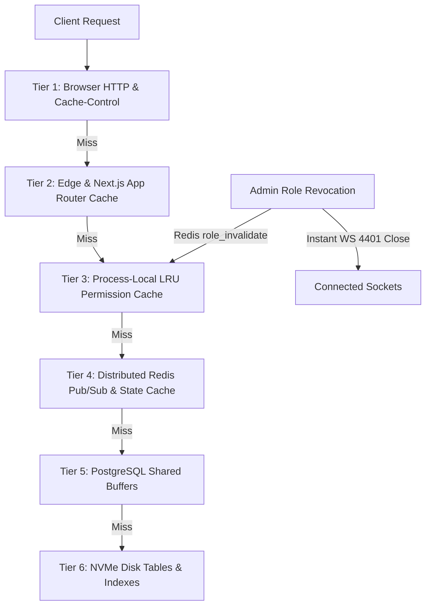

# Domain 10: Multi-Tier Caching Architecture, TTL Contracts & Data Invalidation

## 1. Executive Summary & 6-Tier Cache Matrix

To support high-concurrency transit operations while minimizing database wire transfer and server costs, ADTU ITMS coordinates six distinct caching tiers.

---

## 2. Exhaustive 6-Tier Cache Matrix

| Cache Tier | Storage Engine | Scope & Keys | Default TTL | Invalidation Trigger |
| :--- | :--- | :--- | :--- | :--- |
| **Tier 1: Browser Assets** | Browser Disk / Memory | Static chunks, fonts, icons | 1 Year (`immutable`) | New deployment (hashed filenames) |
| **Tier 2: Edge Next.js Cache** | Vercel Edge / Server Cache | Prerendered HTML (`/`, `/terms`, `/privacy`) | `stale-while-revalidate` (1h) | Git push & production redeployment |
| **Tier 3: In-Memory LRU Cache** | Node.js Process Heap | User role resolution, moderator bitmasks | 60 seconds | Redis `role_invalidate` broadcast |
| **Tier 4: Distributed State Cache** | Redis 7 Memory Cluster | Active bus locations, waiting flags | 24 hours (`EXPIRE 86400`) | `end_trip_atomically` / stop cleared |
| **Tier 5: PostgreSQL Shared Buffers** | Database Engine RAM | Master routes, geofences, fee settings | Dynamic OS paging | Table `UPDATE` / `VACUUM` |
| **Tier 6: Relational Tables** | PostgreSQL 16 Storage | Authoritative permanent records | Permanent | ACID transaction commit |

---

## 2.1 Singleflight In-Flight Promise Deduplication & L1 Memory Caches

To eliminate redundant database wire traffic during peak commute hours, client-side data services (`dataService.ts`, `fleet.client.ts`, `route.client.ts`) implement singleflight request coalescing:
1. **In-Flight Promise Coalescing:** If multiple dashboard widgets or page sections request bus or route data concurrently, only one HTTP request is dispatched. All subsequent callers attach to the in-flight Promise.
2. **L1 Memory Cache:** Successfully resolved responses are cached in memory with a 60-second TTL.
3. **Manual Purge & Invalidation:** Calling `clearCached()` on pull-to-refresh or explicit refresh buttons immediately purges the L1 cache. Any administrative entity mutation (creating, updating, or deleting a bus or route) automatically invalidates cached records.

---

## 3. Cache Invalidation Contracts Across Domains

### 3.1 Role & Permission Invalidation (`INV-AUTH-003`)
1. Admin demotes a user or updates moderator permissions.
2. Next.js API executes `supabase.from('users').update(...)`.
3. Server publishes user ID to Redis channel `role_invalidate`.
4. All running WebSocket cluster nodes receive the broadcast, purge process memory cache (`tokenAuthCache.delete(uid)`), and terminate connected sockets with code `4401`.

### 3.2 Trip Teardown Cache Eviction (`INV-TRIP-003`)
1. Driver ends trip via `/api/driver/end-trip`.
2. PostgreSQL executes `end_trip_atomically`.
3. Redis worker deletes `buses:active:{busId}` and `flags:{busId}`.
4. Redis publishes `{"type":"TRIP_ENDED","busId":"..."}` on `trip:events`, triggering instant map marker removal on student devices.
