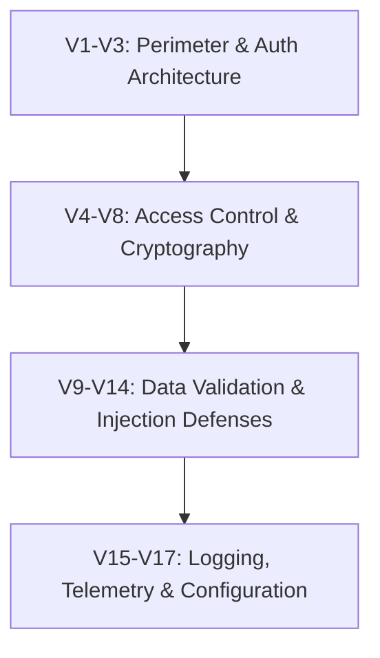

# Domain 10: Full-Stack Security, OWASP ASVS 5.0.0 & Production Freeze Gates

## 1. OWASP ASVS 5.0.0 Compliance Matrix

The platform conforms to the Open Web Application Security Project (OWASP) Application Security Verification Standard (ASVS 5.0.0) Level 2/3 baseline:



| ASVS Chapter | Domain & Objective | ITMS Production Implementation | Verification Proof |
| :--- | :--- | :--- | :--- |
| **V1: Architecture** | Threat modeling & trust boundaries | Multi-tier trust model; zero service_role bypass in client; edge proxy. | Architectural audit; complete schema RLS. |
| **V2: Authentication** | Password & credential security | Firebase Auth Admin SDK; timing-safe bootstrap admin; session expiry. | `first-admin-bootstrap.test.ts` |
| **V3: Session Management** | Token binding & revocation | Single-device driver locking (`device_sessions`); instant WS eviction (4401). | `device-session-cache.test.ts` |
| **V4: Access Control** | Horizontal & vertical RBAC | 6-category moderator bitmasks; strict anti-IDOR checks in all API routes. | `security-boundaries-master.test.ts` |
| **V5: Validation & Sanitization**| Input bounds & injection defense | Prototype pollution stripping (`stripUnsafeObjectKeys`); Zod schema validation. | `config.service.test.ts` |
| **V6: Cryptography** | Strong encryption & signatures | 128-bit HMAC-SHA256 QR passes; `crypto.timingSafeEqual` signature validation. | `qr-token.service.test.ts` |
| **V7: Error Handling** | No information leakage | Sanitized JSON error envelope; zero stack traces exposed to clients. | `error-classes.ts` |
| **V8: Data Protection** | Transit privacy & sensitive data | Zero PII in public logs; immutable financial ledger (`protect_completed_payments`). | `ledger-immutability-trigger.test.ts` |
| **V9: Communications** | TLS & WebSocket security | NGINX TLS termination; First-Message WS auth; query token prohibition. | `websocket-server.test.ts` |
| **V10: Malicious Code** | Prototype pollution & dependencies| Clean npm audit; safe object keys stripping; zero unverified scripts. | `object-safety.ts` |
| **V11: Business Logic** | Concurrency & race condition defense | `SELECT FOR UPDATE` locks; deterministic `id ASC` sorting; atomic RPCs. | `stress-trip-lock.test.ts` |
| **V12: File Upload** | Safe media ingestion | Cloudinary authenticated upload; strict MIME type and file size validation. | `upload.ts` |
| **V13: API Security** | REST & RPC security boundaries | Strict CSRF origin validation; trusted IP resolution from NGINX header. | `security-boundaries-master.test.ts` |
| **V14: Configuration** | Hardened server settings | Strict environment variable boot validation; zero default privileged tokens. | `env-validator.ts` |

---

## 2. The 4 Production Release Gates

Before code is certified for production deployment, it must pass all four release gates unconditionally:

```text
  ┌────────────────────────────────────────────────────────────────────────┐
  │ GATE 1: TypeScript 5.x Static Compilation                              │
  │ Command: npx tsc --noEmit                                              │
  │ Standard: Exit Code 0 | Zero type errors across all 224 routes         │
  ├────────────────────────────────────────────────────────────────────────┤
  │ GATE 2: ESLint Code Quality & Architecture Linter                      │
  │ Command: npm run lint                                                  │
  │ Standard: Exit Code 0 | Zero unhandled lint errors                     │
  ├────────────────────────────────────────────────────────────────────────┤
  │ GATE 3: Automated Vitest Regression Battery                            │
  │ Command: npx vitest run --run                                          │
  │ Standard: 80 Test Files | 672 Passed (100%) | 0 Failures | Exit Code 0 │
  ├────────────────────────────────────────────────────────────────────────┤
  │ GATE 4: Next.js Turbopack Production Build                             │
  │ Command: npm run build                                                 │
  │ Standard: Exit Code 0 | 224 static and dynamic routes compiled         │
  └────────────────────────────────────────────────────────────────────────┘
```
