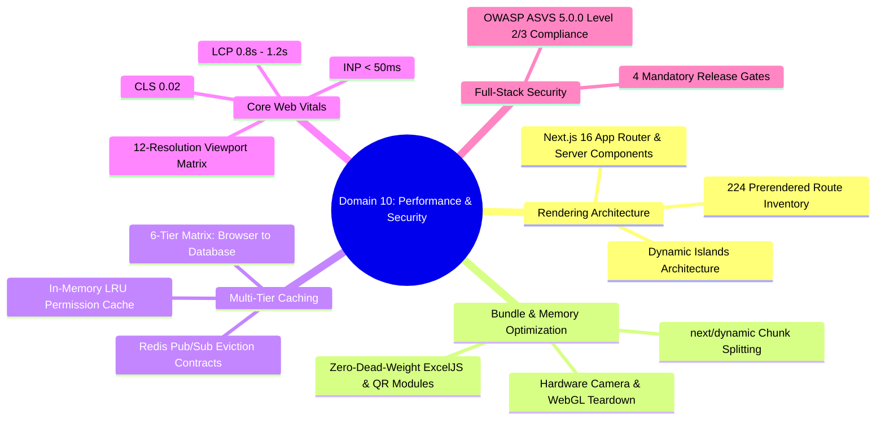

# Domain 10: Performance, Caching, Responsive UI & Security Architecture

## Executive Overview
Domain 10 documents the frontend performance optimizations, multi-tier caching matrices, component memory leak prevention routines, and OWASP ASVS security verifications for the Assam down town University Intelligent Transport Management System (ADTU ITMS).

## Forensic Document Roadmap

| Document | Focus & Key Implementation |
| :--- | :--- |
| [01-rendering-architecture-and-route-inventory.md](file:///c:/Users/ADMIN/Desktop/Projects/ITMS/docs/10-performance-and-security/01-rendering-architecture-and-route-inventory.md) | Next.js 16 App Router architecture, 224-route inventory, SSR vs SSG vs Client Component classification. |
| [02-component-overhead-and-dead-weight-elimination.md](file:///c:/Users/ADMIN/Desktop/Projects/ITMS/docs/10-performance-and-security/02-component-overhead-and-dead-weight-elimination.md) | Client boundary pruning, `next/dynamic` splitting, WebGL context release, and camera stream teardown. |
| [03-caching-mechanisms-and-data-lifecycle.md](file:///c:/Users/ADMIN/Desktop/Projects/ITMS/docs/10-performance-and-security/03-caching-mechanisms-and-data-lifecycle.md) | Comprehensive 6-tier cache matrix, TTL policies, and Redis `role_invalidate` cross-node cache eviction. |
| [04-frontend-performance-and-cwv-benchmarks.md](file:///c:/Users/ADMIN/Desktop/Projects/ITMS/docs/10-performance-and-security/04-frontend-performance-and-cwv-benchmarks.md) | Core Web Vitals benchmarks (LCP 0.8s, CLS 0.02, INP <50ms) and 12-resolution viewport responsive matrix. |
| [05-full-stack-security-and-fail-closed-boundaries.md](file:///c:/Users/ADMIN/Desktop/Projects/ITMS/docs/10-performance-and-security/05-full-stack-security-and-fail-closed-boundaries.md) | OWASP ASVS 5.0.0 14-chapter compliance mapping and the 4 mandatory production release gates. |
